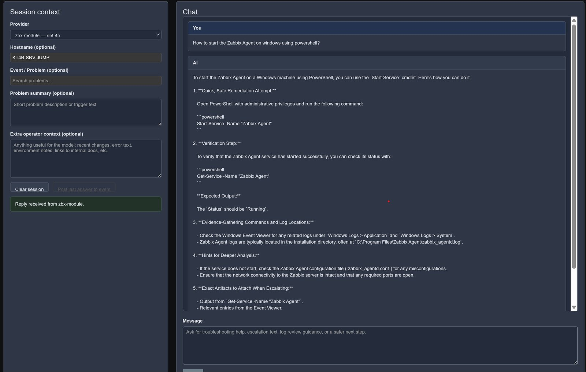
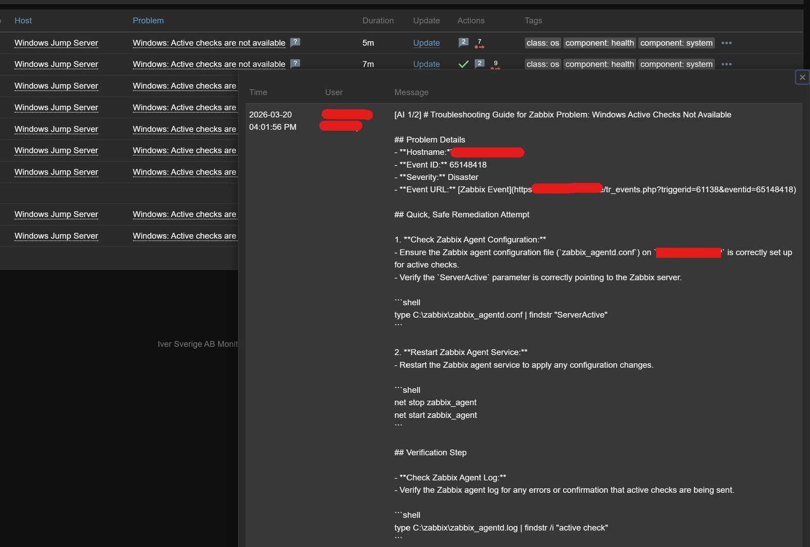
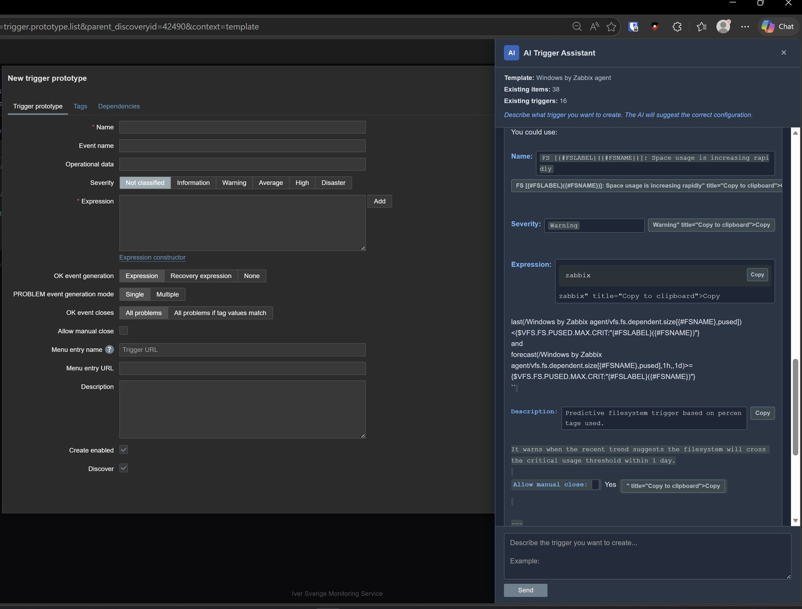
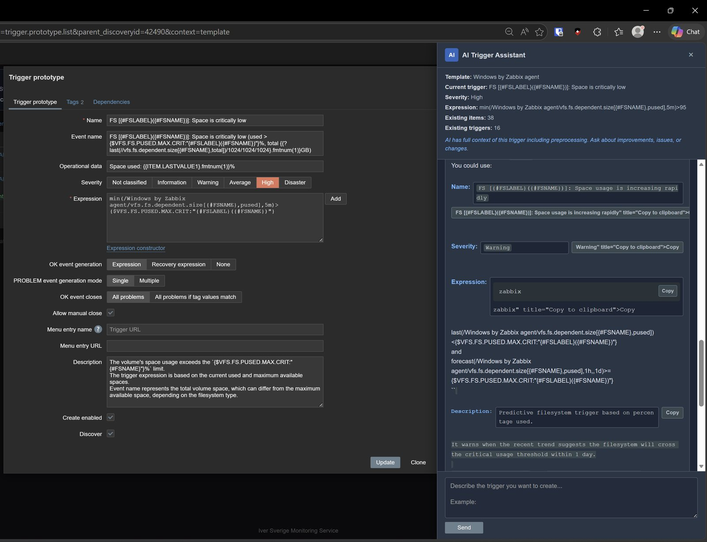
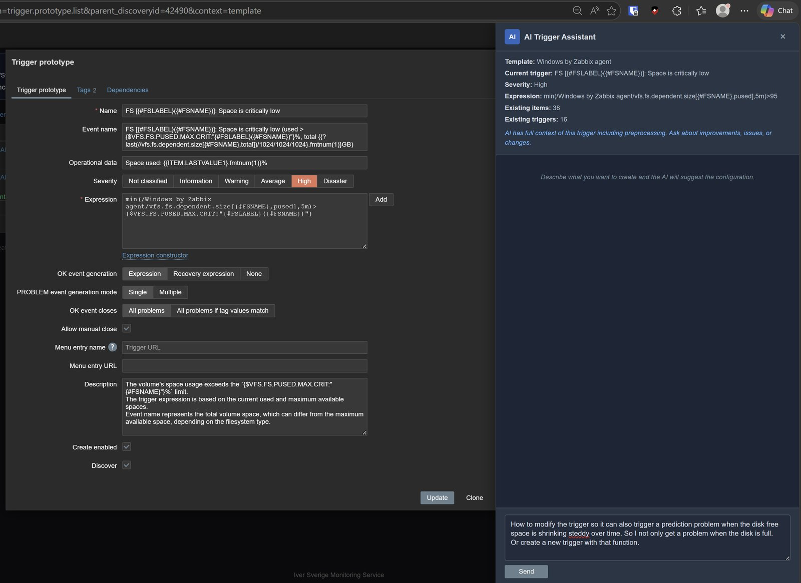
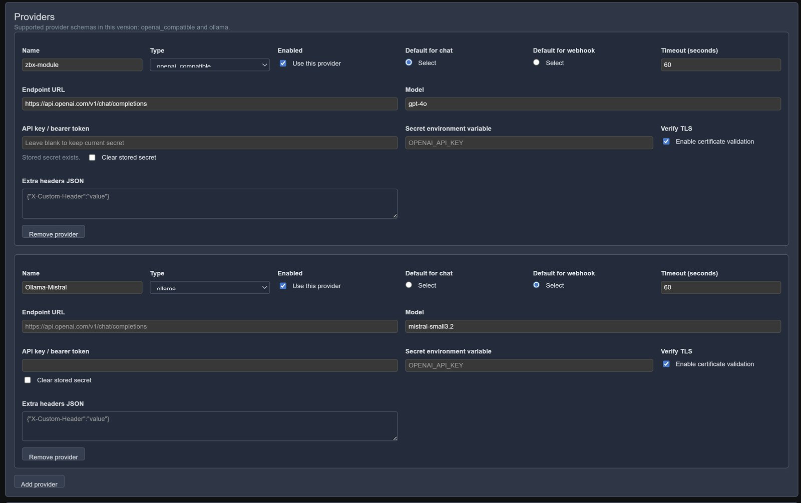
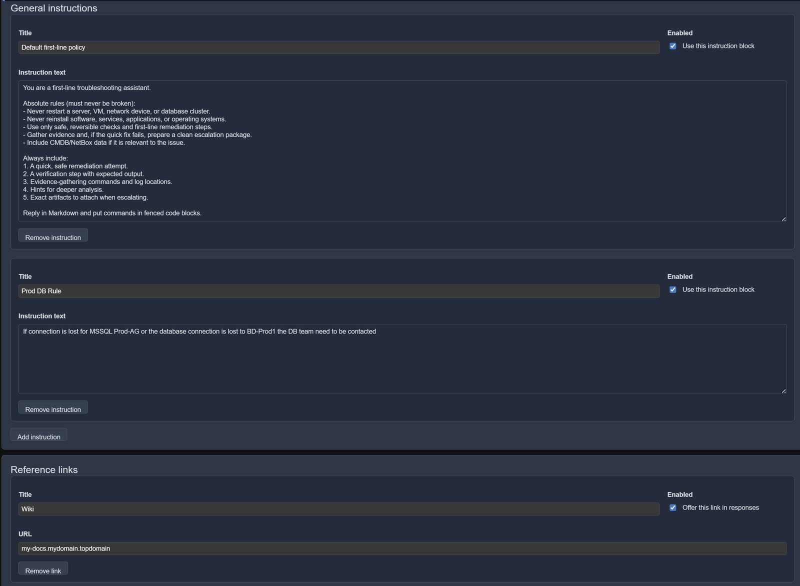

# AI frontend module for Zabbix 7

A self-contained Zabbix frontend module that adds:

- **Monitoring > AI > Chat** for operator chat inside Zabbix
- **Monitoring > AI > Settings** for provider, instruction, secret, privacy, logging and integration management (Super Admin only)
- **Monitoring > AI > Logs** for local audit log review (Super Admin only)
- **Inline AI buttons on the Problems page** with a side-drawer chat for instant problem analysis
- **AI-powered Zabbix actions** via natural language (query problems, create maintenance, modify triggers, manage host groups, etc.)
- **`/ai-webhook`** as a standalone webhook endpoint for problem enrichment and AI-generated guidance
- **Problem update posting** back to the originating event through the Zabbix API
- **Item history / trend analysis** on demand for deeper AI-driven diagnostics
- **Local outbound redaction / inbound restore** for hostnames, IPs, domains, URLs, OS hints and custom replacements
- **Server-side confirmations** for writes and privacy-sensitive reads — encrypted at rest when an encryption key is configured — so executable parameters and external source identities are not trusted from the browser
- **Per-provider temperature and max token controls** for fine-grained model tuning
- **Local JSONL audit logging** with retention and archive support
- **Optional NetBox enrichment** for VM/device/service context
- **AI assistant on item, trigger and discovery rule forms** (and their prototypes) that suggests a configuration or reviews the one being edited

## Screenshots

**Chat** (Monitoring → AI → Chat): session context on the left, the answer in Markdown on the right.



**Webhook answer posted to the problem**: the troubleshooting guide is added to the event as a problem update.



**Form assistant**: on a new trigger prototype the assistant suggests name, severity, expression and description with copy buttons. On an existing trigger it gets the full configuration as context and can review or change it.







**Settings**: providers, instruction blocks and reference links.





## What this module does

### Problem page integration

- **AI buttons** appear next to each problem on the Problems page (Monitoring > Problems)
- Clicking a button opens a **side drawer** with the full problem context (trigger name, expression, host, severity, template, related items)
- The drawer automatically starts an AI analysis of the problem (configurable)
- **Include history** button fetches recent item history/trend data and sends it to the AI for deeper analysis
- **Post to event** button posts the AI answer back to the problem as an update comment
- **Full chat** button transfers the conversation to the full AI Chat page with history preserved
- Buttons are only visible to users with module access (controlled via `getAssets()` user type check)
- Survives AJAX table refreshes via MutationObserver
- Per-event in-memory chat state (no cross-contamination between different problems)

### Chat page

- Session-only chat UI inside Zabbix
- Chat history is stored in **browser `sessionStorage` only**
- No server-side chat persistence is implemented by the module
- A separate server-side alias map is used only when redaction is enabled so masked values can be restored safely during the same chat session
- Optional context fields: Event ID, hostname, problem summary, extra operator context
- **Include history** fetches item history for the selected event, displays it locally as non-forwardable monitoring data, and sends it through the untrusted-data channel only with a fixed operator instruction
- Button to post the **last AI answer** back to a Zabbix event as problem update comments
- **AI-powered Zabbix actions**: ask questions or give commands in natural language
- Full conversation transfer from the problem drawer via localStorage bridge

### AI data preview

An optional preview shows a filtered view of provider data after outbound redaction, before
the initial AI request. Preparing it does not call the model or execute AI
tools. After sending, the chat can show the request bodies captured for that
turn, including later tool-result requests. The initial preview cannot predict
those later requests.

A Super Admin controls **Data preview visibility** under **AI Settings > Chat**:
off (default), Super Admin only, or all authenticated
users with module access. Provider credentials, HTTP headers, administrator
system instructions, private reference links and tool definitions are excluded.
The display is a filtered view of the data, with masked runtime context shown
separately. Preview access does not grant access to additional Zabbix objects
or tools.

Preview snapshots stay in the current page's memory and are not added to chat
history, browser storage, reports or preview files. Existing audit-log settings
continue to govern logging of actual requests independently. Request status
distinguishes a prepared preview or attempted send from a completed send;
oversized snapshots are explicitly marked as truncated.

### Chat and AI Security
- **Replaces sensitive values (hostnames, IPs, domains, URLs, OS names) with safe aliases before sending data to the AI provider. When the AI responds, aliases are restored locally so you see the real values.**
- Example: prd-web-001 becomes ai-host-001 outbound. The AI works with the alias. When the reply comes back, ai-host-001 is replaced with prd-web-001 before you see it.
- An FQDN that belongs to a known host keeps the correlation: prd-web-001.corp.example.net becomes ai-host-001.example (same alias number as the host), while unrelated domains become ai-domain-001.example.
- More information and setup is found in Security / redaction settings in the module

The **Replace these categories before send** settings also include:

| Category | Default | Example |
|---|---|---|
| Passwords and tokens | On | Recognized credentials become `[REDACTED]` |
| Email addresses | On | `alice@example.com` → `ai-person-001@example.invalid` |
| User and account names | Off | `user=alice` → `user=ai-account-001` |
| MAC addresses | Off | `00:11:22:33:44:55` → `ai-mac-001` |
| Serial numbers and asset tags | Off | Recognized identifier fields → `ai-asset-001` |
| Personal folder names | Off | `/home/alice/logs` → `/home/ai-user-001/logs` |

Passwords and tokens are removed without storing their values in alias state
or restoring them in replies. The other categories use consistent, locally
restorable aliases. These controls follow the enabled redaction channels;
recognition is pattern-based, so custom rules remain useful for site-specific
formats. Previously saved choices are preserved when an older settings client
omits the new fields.

### AI-powered Zabbix actions

When enabled, you can type natural language commands in the chat and the AI will interact with Zabbix on your behalf. Examples:

**Routine read actions** (execute immediately):

- "What is the uptime for server1"
- "What OS does DB-server5 have"
- "Summarize CPU utilization for server1"

**Privacy-sensitive reads** (show a source/provider preview and ask for confirmation):

- "Give me a list of all unsupported items"
- "Show me all unacknowledged problems with severity High or above"
- "Show noisy triggers or active maintenance across the environment"
- "Show the event timeline or related problems for event 12345"
- "Show me all triggers for host web-01"
- "List items on host db-01 that contain 'cpu'"
- "List the NetBox inventory"

**Write actions** (always ask for confirmation first):

- "Create a maintenance window for host db-01 for 2 hours"
- "Create a maintenance window for host db-01 for 2 hours on 2026-05-21 starting at 16:00"
- "Change trigger 12345 severity to High"
- "Acknowledge problem event 12345 with message 'Investigating'"
- "Disable item 'CPU idle time' on host web-01"
- "Add all hosts with the MSSQL template to a 'Microsoft SQL Servers' host group"
- "Create a host group called 'Linux Web Servers'"

#### How it works

1. The selected provider receives the enabled Zabbix operations through its native tool/function schema
2. When you ask for Zabbix data or an action, the model requests exactly one provider-native tool call
3. Routine **read** actions execute immediately
4. Privacy-sensitive reads show the exact provider, Zabbix identity and applicable NetBox source before **Confirm / Cancel**; confirmed output is shown once and not retained in provider-forwardable chat history. An administrator can lower that gate **for the Problems-page AI drawer only** (Settings → Zabbix actions → *Problems-page AI drawer: privacy confirmations for reads*, `off` by default) so triage starts on the first click. Writes are never affected.
5. **Write** actions show a deterministic server-generated preview with the exact Zabbix execution identity/destination and **Confirm / Cancel**; high-impact operations require a second click
6. Only the server-stored, hash-bound pending action can execute after confirmation (encrypted at rest when an encryption key is configured)
7. Native tool metadata is not rendered as chat text; JSON-looking assistant prose is ordinary text and can never execute

#### Available tools

The AI exposes a large, growing set of tools (dozens of read and write actions) spanning problem
triage, host/trigger/item diagnostics, maintenance, problem operations, audit-log search, reporting,
notification visibility, configuration context, and NetBox inventory.

Because this set changes as tools are added, it is **not** hand-maintained here — that list always
drifts. The authoritative, always-current catalog is generated directly from the module code
(`ZabbixActionExecutor::allTools()`):

- **In the UI:** Settings → **Zabbix** tab → *Zabbix actions* → the **"?"** help box lists every tool,
  grouped by read/write and by write-permission category, with live counts.
- **Programmatically:** `GET zabbix.php?action=ai.actions.catalog` (Super Admin) returns the full
  registry as JSON — names, descriptions, parameters, categories, and counts.

Representative examples — reads: `get_problems`, `get_host_info`, `get_items`, `get_metric_summary`,
`get_host_interfaces`, `get_trigger_dependencies`, `get_noisy_triggers`, `get_audit_log`,
`get_service_impact`; writes: `create_maintenance`, `update_trigger`, `update_item`,
`acknowledge_problem`, `change_problem_severity`, `suppress_problem`, `add_hosts_to_group`.

#### Permission model

- **Read tools**: Available to logged-in, non-Guest Zabbix users when Zabbix actions are enabled; fleet problem/maintenance, event-comment, inventory, item/trigger, contact, macro, NetBox, audit and bulk-preview reads pause for privacy confirmation
- **Write tools**: Require all of the following:
  - Mode set to "Read & Write" in settings
  - The corresponding write category shown in AI Settings enabled
  - Super Admin role (configurable, enabled by default)
- The AI only sees tools the current user is permitted to use
- All permissions are enforced server-side as a second layer

### Settings page

Every settings section has a **?** button that shows inline help with a short explanation of the feature, what each setting does, and the Linux commands needed to set up directories and permissions.

You can add/remove/manage:

- Providers (with separate defaults for chat, webhook, and Zabbix actions)
- **Per-provider temperature and max tokens** (override global defaults per provider)
- Global instruction blocks
- Reference links
- Zabbix API settings
- NetBox settings
- Webhook behavior
- Chat behavior (history limit, temperature, item history period and max rows)
- **Problem page integration** (auto-analyze on/off)
- **Security / redaction** (enable/disable masking, categories, custom exact/regex/domain-suffix rules, local alias-state path, strict mode)
- **Logging** (enable/disable, categories, log path, archive path, retention, payload logging, mapping-detail logging)
- **Zabbix Actions** (enabled/disabled, read/readwrite mode, granular write permissions including hostgroups)

### Provider types supported

- `openai_compatible` - OpenAI, Azure OpenAI, vLLM, LocalAI, any `/chat/completions` endpoint (defaults to `api.openai.com` when endpoint is left blank). AI actions require native `tools`/function-calling support.
- `ollama` - Local or remote Ollama instances (defaults to `localhost:11434`)
- `anthropic` - Anthropic Claude API (native Messages API support, defaults to `api.anthropic.com`)

## Installation

See [INSTALL.md](INSTALL.md) for the setup helper and platform details.

Quick summary:

1. Copy the `AI` directory into your Zabbix modules folder (e.g. `/usr/share/zabbix/modules/`)
2. Run `sudo bash AI/bin/setup.sh --fpm-pool-config <your-pool.conf> --apply-fpm` from the parent directory. It creates runtime directories and a protected `/etc/zabbix-ai/master.key`, without replacing an existing key. Use `--dry-run` first to review the plan.
3. Apply SELinux labels if needed, validate the PHP-FPM configuration and reload the serving pool.
4. In Zabbix: Administration > General > Modules > Scan directory > Enable AI.
5. As Super Admin, open Monitoring > AI > Settings, add a provider/key and save. Reopen Settings for automatic setup checks.
6. Use **Test connection** and, for actions, **Test model and tools**. Start in Read only mode; interactive chat uses the signed-in user's permissions without a separate service token.

The master key protects inline credentials and pending confirmations at rest.
Back it up securely and use the same key on every frontend node. Optional
`env:NAME`/`file:NAME` references and explicitly approved plaintext compatibility
mode remain supported; see [ENCRYPTION.md](ENCRYPTION.md). New installations
enable audit metadata with message payloads/mappings off; existing settings are
preserved.

## Recommended initial configuration

### 1. Provider

For OpenAI-compatible APIs:

- **Type:** `openai_compatible`
- **Endpoint:** Leave blank for `https://api.openai.com/v1` (or set a custom endpoint)
- **Model:** e.g. `gpt-4.1-mini`
- **API key:** enter the key after running setup; it is encrypted in the database. An `env:NAME` or `file:NAME` secret reference is an optional alternative.
- **Temperature:** Leave blank to use global default, or set per-provider (0-2)
- **Max tokens:** Leave blank for provider default, or set a specific limit
- **Test connection:** Click the button on each provider row to verify connectivity. On success, the model field becomes an autocomplete populated with the provider's available models. Picking a model that requires the default temperature (e.g. GPT-5, o1/o3/o4 series) auto-sets temperature to 1.
- **Test model and tools:** sends two small synthetic requests to verify chat and native tool calling for the selected model. Listing models alone does not verify these capabilities.
- **HTTP exception:** HTTPS is the default. A Super Admin can allow HTTP per provider or for NetBox when an internal endpoint requires it; that connection is unencrypted.

For Ollama:

- **Type:** `ollama`
- **Endpoint:** Leave blank for `http://localhost:11434/api/chat` (or set a custom URL)
- **Model:** e.g. `llama3.1:8b`, `qwen2.5:7b`, `mistral-nemo`. Choose an Ollama model/version with native tool support when Zabbix Actions are enabled.
- **Context window (Ollama):** sets Ollama's `num_ctx`. Defaults to 16384 so the policy and native tool definitions fit without truncation.

For Anthropic (Claude):

- **Type:** `anthropic`
- **Endpoint:** Leave blank for `https://api.anthropic.com` (or set a custom URL)
- **Model:** e.g. `claude-sonnet-4-20250514`
- **API key:** enter the key for encrypted database storage, or use an `env:NAME` or `file:NAME` reference
- **Max tokens:** defaults to 4096 if not set

### 2. Zabbix API

For logged-in frontend users, the module prefers Zabbix's internal frontend API path for chat actions, problem-page context, item history, host/problem lookup, and user-confirmed writes. This uses the current frontend user's Zabbix permissions and avoids a fragile HTTP call back to `api_jsonrpc.php` in split frontend deployments.

Configure a Zabbix API URL and token for webhook/standalone automation. The URL must be an explicit HTTPS URL pointing to the Zabbix web frontend's `api_jsonrpc.php`, not the Zabbix server daemon; it is never derived from the incoming request host.

Interactive reads fail closed if the current frontend user's API identity is unavailable. For a split or token-only deployment, an administrator can explicitly enable **Allow interactive reads to use the shared service token**. This changes those reads to the service token owner's Zabbix scope, so enable it only when that broader identity is intended.

Example:

- **API URL:** `https://zabbix.example.se/api_jsonrpc.php`
- **Auth mode:** `bearer`
- **Token secret reference:** `env:ZABBIX_API_TOKEN` or a confined `file:NAME`

**Important:** Write permissions are still controlled by AI Settings > Zabbix Actions before any write is executed. When using the internal frontend API path, Zabbix also enforces the logged-in user's normal frontend/API permissions. When using the explicitly enabled HTTP token fallback or webhook path, the token needs sufficient read/write access for the allowed operations. `auto` authentication never retries mutating calls and only falls back for read-only `*.get` methods after an explicit authentication rejection.

### 3. Zabbix Actions

In AI Settings > Zabbix Actions:

- **Enabled:** Check to allow AI-powered Zabbix interactions
- **Mode:** "Read only" (default) or "Read & Write"
- **Write permissions:** Enable the corresponding category shown in AI Settings (including maintenance, items, triggers, users, problems, host groups, hosts, interfaces, web, dashboards, templates, discovery, bulk and SLA)
- **Require Super Admin for write:** Enabled by default. When checked, only Super Admin users can execute write actions
- **Web scenario allowed origins:** Required before the AI can create an HTTP web scenario. Scheme and port are enforced; loopback, link-local and metadata destinations remain blocked.

Tool execution uses each provider's native structured-tool protocol. JSON-looking assistant prose is never executable. Every write is rendered into a deterministic server-side preview, bound by SHA-256 to the exact parameters, Zabbix execution identity/destination and server-resolved target identities, encrypted at rest when an encryption key is configured, revalidated against Zabbix before execution, and consumed atomically. Bulk, destructive, and SLA scope-widening writes require a second explicit confirmation. Fleet problem/maintenance, event-comment, broad inventory, contact, macro, NetBox, and audit reads require a privacy confirmation. A key supplied through `ZABBIX_AI_ENCRYPTION_KEY_FILE` or the legacy direct variable is what makes that preview encrypted at rest and the identity binding keyed; without it, confirmed actions and bulk previews run only under the warned development compatibility mode, with unencrypted staging.

For AI-created web scenarios, also enforce outbound network policy on the Zabbix servers/proxies which execute the check. The application allowlist and restricted-address checks are defense in depth; an egress firewall/proxy remains the final protection against DNS rebinding or later DNS changes.

### 4. Provider defaults

You can set different default providers for:

- **Chat** - used for chat turns when Zabbix Actions are disabled for that turn
- **Webhook** - used for automated webhook responses
- **Zabbix actions** - used for every action-enabled chat turn, whether or not the model ultimately calls a Zabbix tool

An operator's explicit provider-selector choice overrides these defaults. This routing makes the provider that receives an action-enabled turn predictable before the model decides whether a tool is needed.

### 5. Chat settings

- **Max history messages:** How many prior messages are sent for context (default 12)
- **Temperature:** Global AI randomness setting (default 1, can be overridden per provider)
- **Item history period:** How far back to fetch item data when "Include history" is clicked (default 24 hours)
- **Item history max rows:** Maximum data points per item (default 50)

### 6. Problem page integration

- **Auto-analyze on open:** When enabled, the AI drawer automatically starts analysis when opened (default on)

### 7. NetBox

Interactive NetBox records are never prefetched into the initial AI prompt. NetBox tools require an explicit sensitive-read confirmation and are scoped to hostnames visible through the current Zabbix API identity. Single-host lookups fail closed unless the exact technical hostname is visible in Zabbix, and bulk NetBox inventory is intersected with that identity's visible Zabbix host list. Normally this is the caller's frontend identity; when the administrator enables split-deployment service-token fallback, it is the token owner's scope. The NetBox endpoint, TLS policy and opaque token identity are bound to the confirmation. The webhook path remains an explicitly configured automation identity protected by the webhook secret.

Optional. If enabled, confirmed interactive tools can retrieve VM/device/service data from NetBox; webhook automation can include the same data as explicitly configured context.

### 8. Webhook

The standalone webhook URL is:

```text
https://your-zabbix-frontend/ai-webhook
```

Configure the web-server mapping in `INSTALL.md` before importing the media type. The endpoint does not need a Zabbix frontend session and must be protected with the shared secret (required by default). Do not enable the Zabbix Guest user or grant Guest access to this module for webhook delivery.

Webhook handling is opt-in for new installations; existing settings are
preserved. Delivery deduplication, rate/concurrency limits and bounded request
sizes protect automated calls. Re-import the bundled media type on upgrade
for recovery/update delivery identities. See the installation guide for
uncertain failures and multi-frontend storage requirements.

## Suggested media type wiring

An example Zabbix webhook script is included in:

```text
mediatype/media_type_ai_webhook.js
```

Suggested media type parameters are documented in:

```text
mediatype/media_type_setup.md
```

## Webhook payload compatibility

The module accepts either:

- a direct JSON payload with fields like `eventid`, `trigger_name`, `hostname`, etc.
- or a payload containing:

```json
{
  "message": "{...json string...}"
}
```

## Security notes

- Inline credentials are encrypted with the deployment key. Optional **`env:NAME` or confined `file:NAME` secret references** keep values out of the database. Explicit plaintext compatibility mode also supports keyless confirmations, pending writes, sensitive reads and bulk previews, without encryption at rest.
- Enable TLS verification unless you have a specific internal reason not to.
- The webhook endpoint does **not** require a logged-in Zabbix UI session, so use a shared secret if you expose it beyond localhost/internal networks.
- Write actions are protected by multiple layers: settings mode, per-category permissions, user role checks, server-side pending action storage (encrypted when a key is configured), deterministic target/value previews, and mandatory user confirmation. Generic AI-authored trigger-expression creation or editing is intentionally unavailable; use Zabbix directly for arbitrary expressions.
- Privacy-sensitive reads use the same pending store (encrypted at rest when a key is configured) and bind the provider plus source identity before retrieving data.
- When Security / redaction is enabled, outbound AI requests can replace hostnames, IPs, FQDNs, URLs, OS hints, and any custom rules you define. Replies are restored locally before operators see them. Enabled administrator reference-link URLs are an intentional exception: they are placed in the system prompt verbatim, so never put credentials or secret query parameters in them.
- The configuration/history assistant sends its displayed form and API context only after an explicit pre-send consent prompt. Depending on the page, this can include preprocessing JavaScript, interface addresses, item/history values, trigger definitions, macro values and recent problem metadata. Secret/vault macros are masked. Untrusted-data fencing prevents instruction confusion but is not data minimization; configure redaction for the selected chat channel as needed.
- Problem page AI buttons are only injected for users with module access (user type check in `getAssets()`).
- Problem context enrichment (trigger, items, templates) is resolved server-side — the browser only passes the event ID, never raw trigger data.
- Logging is local file-based and redacted by default. Storing alias-to-original mapping details is available but intentionally off by default because it is higher risk.

## Important limitations

- No chat persistence by design
- No external FastAPI service required
- The module does **not** create any new Zabbix DB tables
- Local redaction state and pending confirmations (writes, sensitive reads and bulk previews) use the configured state path (new-install default `/var/lib/zabbix-ai/state`); they are encrypted when a key is configured and readable plaintext under compatibility mode. Reports default to `/var/lib/zabbix-ai/reports`.
- Local JSONL logs default to `/var/log/zabbix-ai`, with archives in `/var/log/zabbix-ai/archive`. Existing saved paths are preserved on upgrade.
- **New installations enable audit metadata by default**, with payloads and alias mappings off. Existing saved logging choices are preserved.
- **Runtime directories must be writable by PHP.** The setup helper creates them; Settings reports configuration and access problems. Keep module code read-only.
- AI-powered Zabbix actions require a provider/model that implements native structured tool calling. JSON-looking model prose is treated only as text and never executed. More capable tool-capable models generally produce better results.
- Item history fetching uses the Zabbix `history.get` API and auto-detects the correct history type (numeric float, unsigned, string, text, or log).

## Quick webhook smoke test

```bash
curl -X POST \
  'https://your-zabbix-frontend/ai-webhook' \
  -H 'Content-Type: application/json' \
  -H 'X-AI-Webhook-Secret: your-shared-secret' \
  -d '{
        "eventid": "123456",
        "event_value": "1",
        "trigger_name": "CPU utilization is too high",
        "hostname": "server01",
        "severity": "High",
        "opdata": "CPU: 97%",
        "event_tags": [
          {"tag": "service", "value": "api"},
          {"tag": "team", "value": "platform"}
        ]
      }'
```
