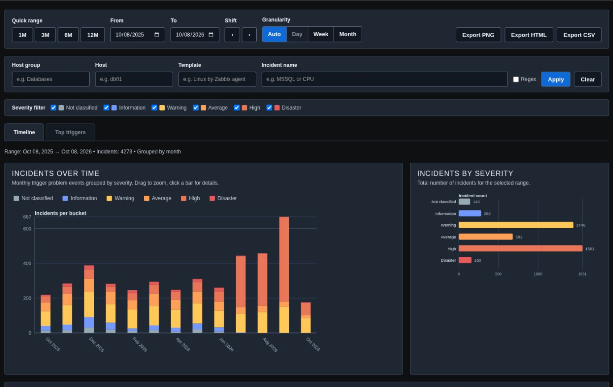
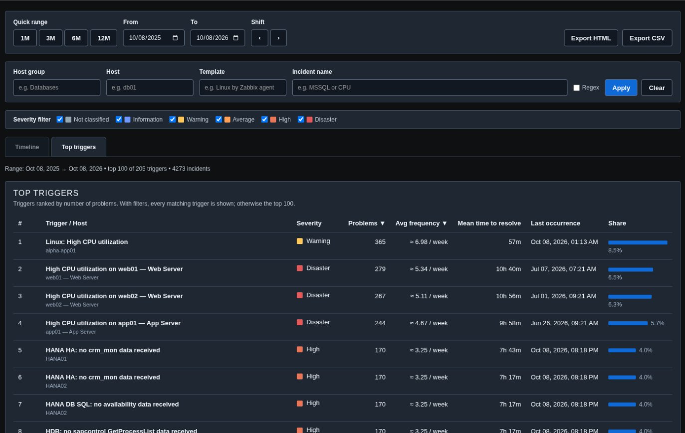
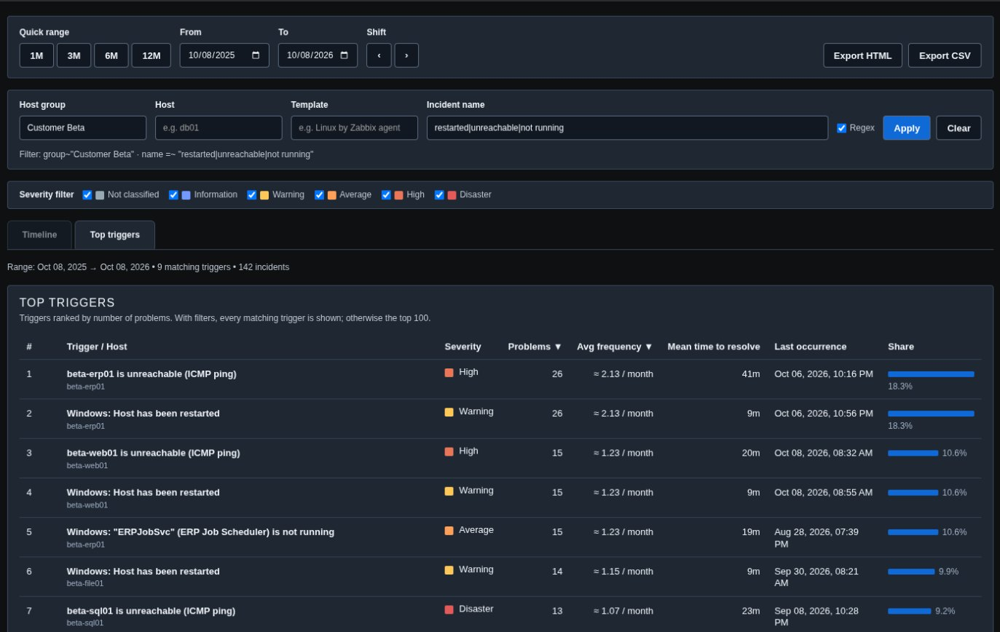

# Incident Timeline Graph

A Zabbix **frontend report module** that visualises trigger problem events over time and ranks the
noisiest triggers — with multi‑month ranges, interactive charts, host/group/template/name filtering
and HTML/CSV/PNG export. It appears under **Reports → Incident Timeline**.

Built and tested on **Zabbix 7.0**.

## Changes in 1.4.0

- Failed API queries and regex evaluation errors are reported as errors instead of zero incidents.
- Changing filters, tabs or severities cancels superseded loads; incomplete severity loads cannot be exported.
- Drill-downs and exported reports retain scan-limit, host-filter and recovery-coverage warnings.
- Resolved events with unavailable recovery timestamps are distinguished from ongoing problems;
  mean time to resolve states how many recovery durations were available.
- Severity selections survive shared links, date presets handle month ends, and UTC is explicit.
- Charts adapt to the available width, and tabs and table sorting support keyboard use.
- Asset filenames include the release version to prevent stale browser caches after updating.

---

## Screenshots

**Timeline** — daily/weekly/monthly incident volume by severity, with an at‑a‑glance severity
breakdown and trend lines. Drag on the chart to zoom, click a bar to drill into that period.



**Top triggers** — every trigger ranked by problem count, with **average firing frequency**
(auto‑scaled per second/minute/hour/day/week/month), **mean time to resolve**, last occurrence and
share of total. With no filter it shows the top 100; with a filter it shows up to 1,000 matching triggers.



**Filtered** — the same filters apply to both tabs, so you can answer questions like *"all MSSQL
incidents on db01"* or *"all Kubernetes incidents in this cluster"*. Incident‑name matching supports
substrings or full regular expressions. Below, one customer's host group with the regular expression
`restarted|unreachable|not running`.



---

## Features

- **Multi‑month ranges** — quick presets (1M/3M/6M/12M), free From/To dates, and a window shift.
  The range cap is ~25 months.
- **Automatic bucketing** — day / week / month is chosen from the range length (or forced via the
  Day/Week/Month toggle) so the chart stays readable whether you look at a week or two years.
- **Interactive charts** (hand‑rolled SVG, no external libraries):
  - hover tooltip with the per‑severity breakdown + column highlight / trend crosshair,
  - **drag‑to‑zoom** into a sub‑range,
  - **click a bar to drill down** into that period's individual incidents (lazy‑loaded),
  - clickable legend that mirrors the severity checkboxes.
- **Top triggers tab** — ranked by problem count, with average frequency, mean‑time‑to‑resolve,
  last occurrence and a share bar. Sortable columns. Top 100 by default, up to 1,000 when filtered;
  the report states how many matching triggers are shown.
- **Filters shared across both tabs** — host group, host, template (all substring-matched) and
  incident name (substring **or regex**), plus the severity checkboxes.
- **Exports** — PNG (charts), HTML (standalone report) and CSV (incident detail, or the top‑triggers
  table). CSV is hardened against spreadsheet formula injection.
- **Dark / high‑contrast theme** aware.
- **Deep‑linkable** — the range, granularity, tab and filters live in the URL.

---

## Built for scale

On large instances a single trigger can fire hundreds of thousands of times a month, so the module
avoids transferring raw event rows wherever possible:

- The **timeline response contains bucket counts**, not event rows. Without a regex filter, it asks
  the database for per-bucket **counts** per severity (`event.get` with `countOutput`). Regex filters
  require a bounded server-side event scan and may therefore produce partial counts.
- Counts load **progressively, most‑severe first** (Disaster → … → Information), each severity as its
  own small request, so users see the important data immediately even when the full load takes a
  while — and each request is small, which reduces the chance of hitting a web‑server timeout.
- The **Top triggers** report must scan events to group them by trigger; it is capped (200k events
  per request) and shows a clear "results may be partial" warning when the cap is hit. Narrowing the
  range or adding a filter can reduce the scan below the cap. Absence of a scan-limit warning does
  not prove older history is retained: results cover events still available to the signed-in user.

> Note on "request limits": Zabbix's *Limit for search and filter results* setting does **not** cap
> `event.get` calls that pass their own limit (this module paginates internally). The practical limits
> at very high volume are PHP `max_execution_time` / `memory_limit` and the web server / PHP‑FPM read
> timeout — the count‑based, progressive design above is what keeps those in check.

---

## Install

1. Copy the `Incident_timeline_graph` folder to the Zabbix **web frontend** server under:
   `/usr/share/zabbix/modules/`
2. Fix permissions (adjust the web user — `nginx`, `www-data`, …):
   ```bash
   sudo chown -R nginx:nginx /usr/share/zabbix/modules/Incident_timeline_graph
   sudo find /usr/share/zabbix/modules/Incident_timeline_graph -type d -exec chmod 755 {} \;
   sudo find /usr/share/zabbix/modules/Incident_timeline_graph -type f -exec chmod 644 {} \;
   ```
   On SELinux systems:
   ```bash
   sudo semanage fcontext -a -t httpd_sys_content_t '/usr/share/zabbix/modules/Incident_timeline_graph(/.*)?'
   sudo restorecon -Rv /usr/share/zabbix/modules/Incident_timeline_graph
   ```
3. In the frontend go to **Administration → General → Modules**, click **Scan directory**, then
   enable **Incident Timeline Graph**.
4. Open **Reports → Incident Timeline**.

Any Zabbix user can view it; the data shown respects each user's host permissions.

### Updating an existing installation

Replace the module folder with the complete updated folder, including `manifest.json` and both
versioned assets. Scan the module directory again, then reload the report. The footer should show
**Incident Timeline 1.4.0**. If PHP opcode caching delays source updates, use your frontend's normal
cache refresh procedure.

After updating, check both tabs with your usual filters, toggle severities, open an incident bucket,
and download an HTML/CSV report. Compare a small date range with Zabbix Problems history using the
same UTC boundaries. Local automated checks use synthetic data; these checks on your Zabbix instance
are still required.

---

## Usage

- Pick a range (preset or From/To), optionally set the granularity, and switch between the
  **Timeline** and **Top triggers** tabs.
- Use the filter bar to scope by host group, host, template and/or incident name (tick **Regex** for
  regular‑expression name matching). The same filter drives both tabs.
- On the timeline: hover for details, drag to zoom (then **Reset zoom**), click a bar to list that
  period's incidents.
- Export the current view as PNG, HTML or CSV.

---

## Notes / limits

- Times are bucketed in **UTC**.
- Maximum range ~768 days; per-request event scan cap 200,000 for Top triggers, incident/CSV detail
  and regex-filtered timeline queries. Ordinary timeline queries use counts.
- Host/template filter resolution is bounded to 5,000 matching hosts and reports truncation.
- Host and template searches match both technical names and visible names.
- Mean time to resolve uses only resolved events with available, valid recovery timestamps. Missing
  timestamps are reported separately; ongoing events are excluded from this average.
- Exports are HTML/CSV/PNG only (no extra PHP libraries are bundled into the frontend).
- If the page is blank after install, check the PHP‑FPM / Nginx / Apache error log for the fatal error.

## Local regression checks

Run from the module directory. The fixtures use synthetic events and intercepted browser requests;
they do not connect to a Zabbix installation.

```bash
php tests/IncidentTimelineDataTest.php
node tests/frontend-regression.cjs
npm ci
npx playwright install chromium
npm run test:browser
```

Alternatively, set `PLAYWRIGHT_CHROMIUM_EXECUTABLE` to an existing Chrome/Chromium executable.
On Windows the browser test uses the standard Chrome installation by default. Set
`INCIDENT_SCREENSHOT_DIR` to save optional light/dark desktop/mobile previews. Node, npm and
Playwright are development tools only; the deployed module has no Node dependency.
