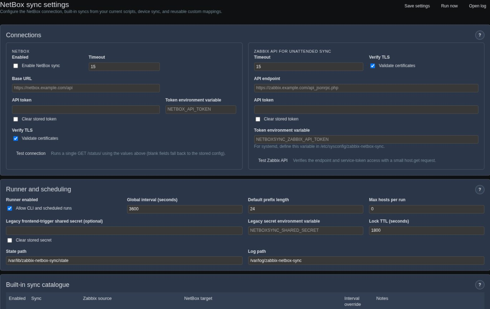
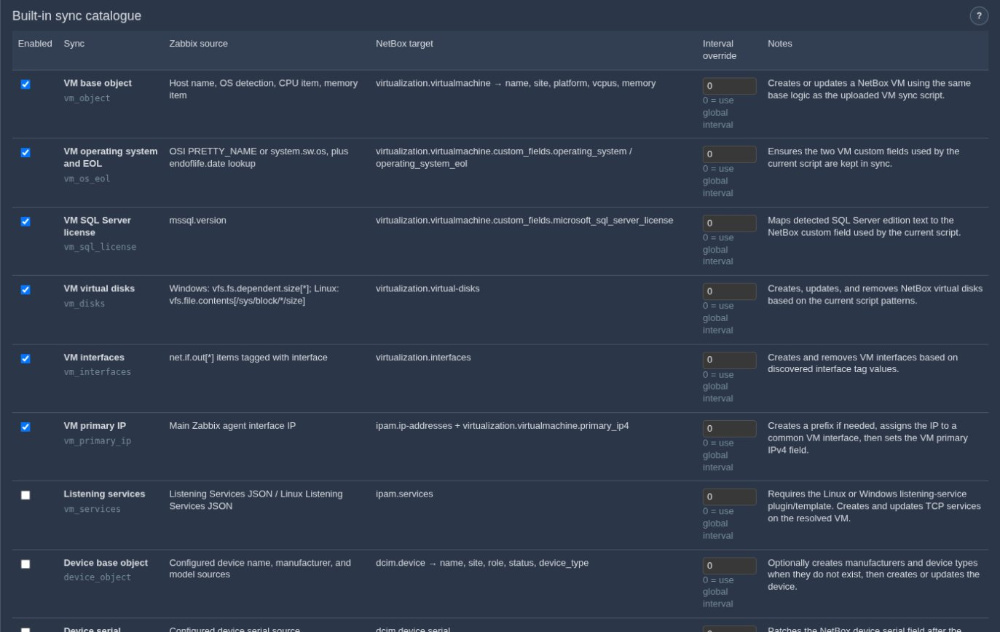

# NetBox Sync module for Zabbix 7

This frontend module adds a configurable NetBox sync page under **Monitoring → NetBox Sync → Settings**.

## What it does

- Syncs Zabbix hosts into NetBox VMs using the logic from the current `sync_zabbix_netbox.py` script:
  - create/update VM
  - operating system + EOL custom fields
  - Microsoft SQL Server license custom field
  - virtual disks
  - interfaces
  - primary IPv4 assignment
- Optionally syncs listening services into NetBox `ipam/services` using the Zabbix listening-service plugins/templates.
- Adds a new device flow for NetBox devices:
  - create/update device
  - resolve or create manufacturer
  - resolve or create device type
  - patch serial
- Exposes every built-in mapping on the settings page with:
  - enabled/disabled toggle
  - Zabbix source description
  - NetBox target description
  - per-sync interval override
- Supports reusable **custom mappings** so you can add more syncs without changing code:
  - direct field patch
  - relation lookup
  - ensure device type

## Screenshots

The screenshots below show the earlier single-page layout. Settings are now
organized into tabs; the connection and sync options remain available.

**Settings**: NetBox and Zabbix API connections, runner and scheduling.



**Built-in sync catalogue**: each sync with its Zabbix source, NetBox target and optional interval override.



## Module structure

- `manifest.json`
- `Module.php`
- `actions/`
- `views/`
- `lib/`
- `bin/`
- `assets/`
- `samples/`

## Service-sync dependency

If you enable the built-in **Listening services** sync, the matching Zabbix plugin/template must be deployed:

- Linux: `https://github.com/Keberneth/Zabbix-Plugins/tree/main/Linux/linux_service_listening_port`
- Windows: `https://github.com/Keberneth/Zabbix-Plugins/tree/main/Windows/windows_service_listening_port`

The default item names expected by this module are:

- `Listening Services JSON`
- `Linux Listening Services JSON`

## Scheduler model

A Zabbix frontend module does not run on its own. The recommended unattended
path is the bundled CLI worker:

```bash
php /usr/share/zabbix/modules/NetBoxSync/bin/netboxsync.php --json
```

It reads this module's settings from the Zabbix frontend database and reads
hosts through the Zabbix JSON-RPC API using a dedicated API token. It therefore
works under systemd or cron with no logged-in user and no browser session.

The frontend `netboxsync.run` action remains available for interactive use,
but it is not an anonymous scheduler endpoint: Zabbix must load the module for
an authenticated user before the controller can run. Use the CLI worker for
session-free scheduling. Ready-to-use systemd and cron examples are included
in `samples/`.

## Secrets

The **Vault / secret reference** fields support a direct HashiCorp Vault KV v2
lookup, for example `vault:secret/data/netbox#api_token`. Configure the Vault
address and authentication credential in the server environment; only the
secret path and key are saved in module settings. Native Zabbix `{$MACRO}`
references are not expanded.

The fields also accept `env:NAME`, a bare environment variable name for
compatibility, or `file:NAME` for secrets supplied by Vault Agent or another
deployment mechanism.

The underlying configuration keys remain:

- `netbox[token_env]`
- `zabbix_api[token_env]`
- `runner[shared_secret_env]`

Alternatively, use `env:NETBOX_API_TOKEN` or `file:netbox-token`. Files are resolved
only below the server-admin-configured `NETBOXSYNC_SECRET_DIR`; a file reference
is a logical filename, never an arbitrary path. See [Vault setup](INSTALL.md#vault-backed-api-tokens)
for a deployment example and environment-variable allowlisting.

When upgrading from 0.2.x, existing custom environment-variable names must be
added to `NETBOXSYNC_ALLOWED_SECRET_ENV_VARS` for PHP-FPM and the CLI service.
The documented token names and `NETBOXSYNC_SECRET_*` names are already allowed.

Selecting a reference removes the corresponding stored inline secret when
settings are saved. An unavailable reference fails with an error instead of
falling back to an old token. Enter either a new inline token or a reference.
Stored inline secrets remain supported for compatibility and are stored in the
Zabbix module configuration database without module-side encryption.

Secrets are never returned to the settings page. PHP-FPM and the CLI service
need access separately: testing a connection in the browser verifies the PHP
frontend environment; CLI `--check` verifies the unattended Zabbix API token.

Interactive **Run now** requests use the logged-in Zabbix frontend session.
Unattended CLI runs use `zabbix_api[url]` plus a dedicated Zabbix API token, so
they are independent of frontend sessions.

## Filesystem permissions

The PHP-FPM user and unattended CLI service account must be able to write to:

- runner state path (default `/var/lib/zabbix-netbox-sync/state`)
- runner log path (default `/var/log/zabbix-netbox-sync`)

**Pre-create both directories before the first run.** `/var/lib` and
`/var/log` are not writable by nginx/apache, so the module cannot create them
itself. `OWNER` must be the **PHP-FPM pool user**, not the nginx user —
check `/etc/php-fpm.d/zabbix.conf` (on RHEL/Alma/Rocky with Zabbix packages
this is usually `apache`, even when the HTTP server is nginx):

```bash
sudo install -d -o "$OWNER" -g "$OWNER" -m 0770 /var/lib/zabbix-netbox-sync/state
sudo install -d -o "$OWNER" -g "$OWNER" -m 0770 /var/log/zabbix-netbox-sync
```

On SELinux systems (RHEL/Alma/Rocky/Fedora), also run:

```bash
sudo semanage fcontext -a -t httpd_sys_rw_content_t '/var/lib/zabbix-netbox-sync(/.*)?'
sudo semanage fcontext -a -t httpd_sys_rw_content_t '/var/log/zabbix-netbox-sync(/.*)?'
sudo restorecon -Rv /var/lib/zabbix-netbox-sync /var/log/zabbix-netbox-sync
```

See `INSTALL.md` for full step-by-step instructions.

## Log page

**Monitoring → NetBox Sync → Log** shows structured sync events in an
Excel-style grid with four tabs: Added, Changed, Removed, Errors. Stack
facets (Host, OS, Target, Sync, Field, Disk) and per-column filters to
isolate changes — e.g. filter OS = `Windows Server 2019` + `Windows Server
2022`, then Sync = `vm_disks`, to see every Windows 2019/2022 disk delta.

## Configuration reference

All settings live on **Monitoring → NetBox Sync → Settings**, grouped into tabs:

| Tab | Contents |
| --- | --- |
| Integrations | NetBox and Zabbix API endpoints, credentials, TLS and connection tests. |
| Scheduling | Runner, intervals, limits, state/log directories and legacy trigger. |
| Built-in syncs | Built-in catalogue, sources, targets and interval overrides. |
| VMs & services | VM creation policy, item sources, units, pruning and listening services. |
| Devices | Device creation policy and manufacturer/model/serial sources. |
| Custom mappings | Editable mappings and insertable examples. |
| Last run | Result, counters, messages and access to detailed logs. |

**Save settings** saves all tabs together. Switching tabs preserves edits.
**Run now** uses saved settings and requires you to save outstanding edits first.

During a run, a live progress bar shows finished host attempts as a percentage
of the hosts fetched for that run. Preparation is indeterminate until the host
count is known; finalization remains below 100% while the run is active.
Failed or skipped host attempts count as finished work, and errors are shown
separately, including when a finished run reaches 100%. This is work progress,
not a success rate or an estimate of time
remaining. Host limits and the API token's permissions still determine the
fetched scope.

Progress is read from an atomic `state/progress.json` snapshot through the
Super Admin-only status action. Each manual run has its own identifier so an
older run's result cannot appear as the new run's progress. If a worker stops
without finishing, its last snapshot is marked interrupted once the runner
lock is free. A failed status request reports progress as unavailable without
starting another run.
When a run cannot start or save its summary, its error stays on the current
page; the UI does not substitute an earlier result from Last run.

Secrets (NetBox token, Zabbix API token, runner shared secret) are never echoed
back to the page — leave the field blank to keep the stored value, or tick
*Clear* to remove it.

### Integrations → NetBox

| Field | Meaning |
| --- | --- |
| Enabled | Master switch for all NetBox writes. A run aborts early if this is off. |
| Base URL | NetBox root, e.g. `https://netbox.example.com` (a trailing `/api` is added automatically). |
| API token | NetBox API token, stored inline for compatibility. Leave blank when using a reference. |
| Vault / secret reference | For example `vault:secret/data/netbox#api_token`, `env:NETBOX_API_TOKEN` or `file:netbox-token`; read at runtime and required when configured. |
| Verify TLS | Validate the NetBox certificate (turn off only for self-signed lab setups). |
| Timeout | Per-request cURL timeout in seconds (5–300). |
| **Test connection** | Runs a single `GET /status/` using the current form's token/reference, clear flag, TLS and timeout. A blank inline token keeps the stored value unless cleared. This is a connectivity check, not a check of every required NetBox permission. |

### Integrations → Zabbix API for unattended sync

| Field | Meaning |
| --- | --- |
| API endpoint | Full JSON-RPC URL, for example `https://zabbix.example.com/api_jsonrpc.php`. |
| API token | Token for a dedicated Zabbix service user with read access to the host groups being synchronized. |
| Vault / secret reference | For example `vault:secret/data/zabbix#api_token`, `env:NETBOXSYNC_ZABBIX_API_TOKEN` or `file:zabbix-api-token`; resolved by the frontend test or CLI consumer. |
| Verify TLS | Validate the Zabbix frontend certificate. Disable only for a controlled lab setup. |
| Timeout | Per-request cURL timeout in seconds (5–300). |
| **Test Zabbix API** | Verifies the current form's credential with a bounded `host.get` request. For credentials available only to systemd, use CLI `--check` from that service account. |

### Runner and scheduling

| Field | Meaning |
| --- | --- |
| Runner enabled | Allow unattended CLI runs and the legacy frontend trigger. |
| Global interval | Default seconds between runs of each sync/mapping unless it overrides it. |
| Default prefix length | Mask used when creating a NetBox prefix for a discovered primary IP. |
| Max hosts per run | 0 = all (capped at 50000). Otherwise processes at most this many hosts. |
| Shared secret / reference | Legacy frontend-trigger secret. It is not used by the CLI worker and does not bypass Zabbix's requirement that the module action be loaded for an authenticated user. |
| Lock TTL | Advisory lock lifetime preventing overlapping runs. |
| State path / Log path | Writable directories for run state and the structured event log (see Filesystem permissions). |

### Built-in sync catalogue
Each row mirrors one step of the original sync scripts (VM base object, OS/EOL,
SQL license, disks, interfaces, primary IP, listening services, device object,
device serial). Toggle rows independently and optionally set a per-row interval
override (`0` = use the global interval).
VM entries also require VM sync to be enabled; listening services additionally
require services to be enabled. Device entries require device sync to be enabled.
Enabling a catalogue row alone does not override those switches.

### VM sync defaults
Item keys/names used to read OS, CPU, memory, SQL version, disks, and interfaces
from Zabbix, plus VM creation policy (create/update/require-OS), the NetBox
memory/disk **unit** (MB vs GB — NetBox 4.3+ stores disk size in GB), and
prune toggles for stale disks/interfaces.

### Listening-services sync
Enables the `vm_services` row. Point `Windows item name` / `Linux item name`
at the items populated by the listening-service plugins/templates.

### Device sync defaults
Device creation policy and the source (mode + value) for device name,
manufacturer, model, and serial, plus auto-create toggles for missing
manufacturers and device types.

### Custom mappings
Reusable, code-free syncs: pick a source (item key/name, static, host name,
agent IP), an optional JSON path + transform, a target object (VM / Device /
Custom URL) and target field. Advanced options add a host-name regex gate
(evaluated under ReDoS guards), relation lookups, and ensure-if-missing logic.

#### Example: device serial into a custom field

In **Custom mappings**, insert the device serial example. It starts disabled
so you can adjust it before saving and enabling it.

| Field | Example value |
| --- | --- |
| Target object | Device |
| Mode | Patch field |
| Source mode | Item key |
| Source value | `fgate.device.serialnumber` |
| Target field | `custom_fields.serial_from_zabbix` |
| Transform | Trim |
| On empty value | Skip |
| Host name regex | `/^FW-/` (replace with your intended host scope) |

First create a text custom field named `serial_from_zabbix` in NetBox for Device
objects. Verify that the source item key exists and has a value on a matching
Zabbix host; this key is specific to the template and may need changing.
Review device naming and **Create missing** in Devices: a custom mapping can
create its target according to those defaults. Use a narrow host-name regex,
enable the mapping, save, run, and inspect Last run and the detailed Log.
For example, item value `FG100F1234567890` becomes the device custom-field value
`serial_from_zabbix = FG100F1234567890`. A missing source value is skipped.

The relation example demonstrates assigning an existing NetBox device role:
use mode **Lookup relation**, target field `role`, endpoint
`/dcim/device-roles/`, query field `name`, and a static source matching an
existing role name. Leave **Ensure if missing** set to **No**.

## Local validation

Run `php tests/SecretReferenceTest.php` and `php tests/VaultClientTest.php`
for offline credential checks. The Vault suite uses a fake HTTP transport;
it does not prove connectivity, certificate trust, or policy access in a live
Vault deployment.
Run `php tests/SyncProgressTest.php` for offline progress and concurrency checks.

For browser checks, render `tests/SettingsViewFixture.php` to a temporary HTML
file, then run `node tests/SettingsUiTest.cjs <temporary-html-file>` with
Playwright and Chrome installed. Set `PLAYWRIGHT_CHROMIUM_EXECUTABLE` when
needed. Run `node tests/SyncProgressUiTest.cjs <temporary-html-file>` for the
live-progress UI scenarios. These checks use the real view and JavaScript
with mocked requests.

## Notes

- End-of-life lookup uses `endoflife.date`, like the current VM sync script logic.
- Device-type matching is intentionally flexible and can reuse existing NetBox device types even when the Zabbix model item contains a friendly string with a code in parentheses, for example `FortiGate 100F (FG100F)`.
