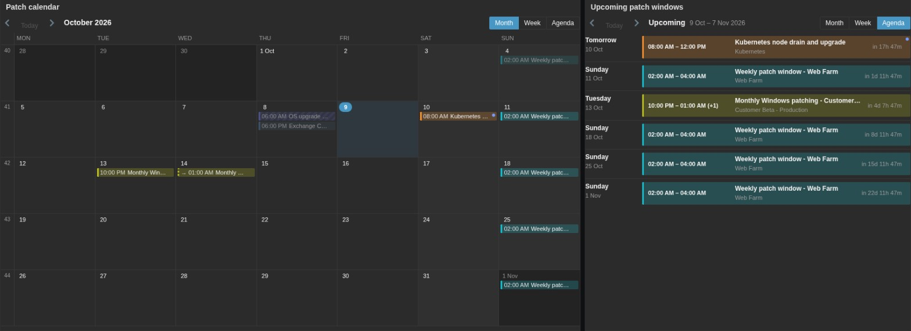
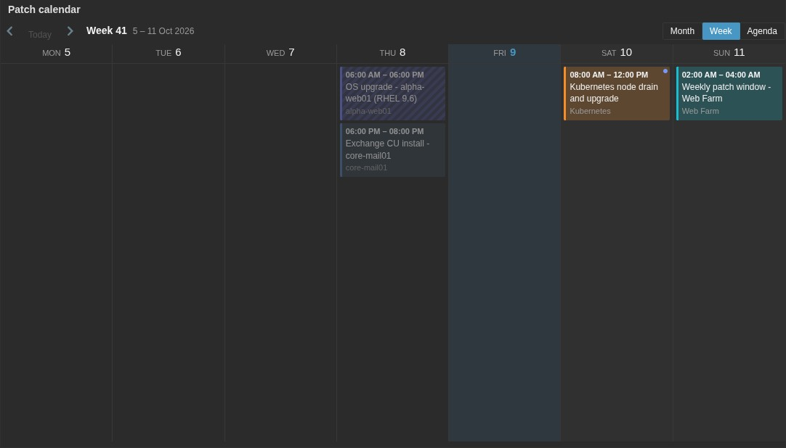
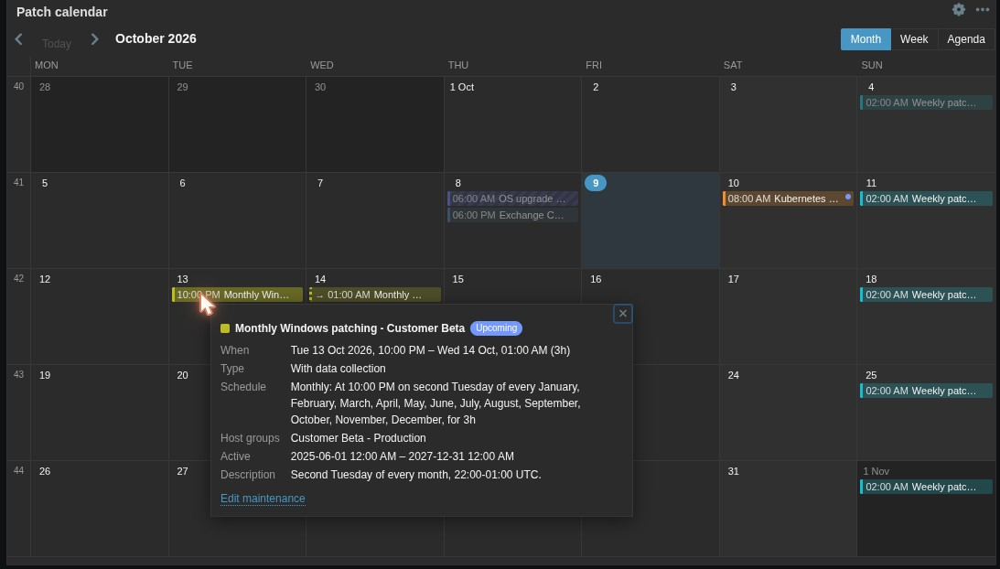
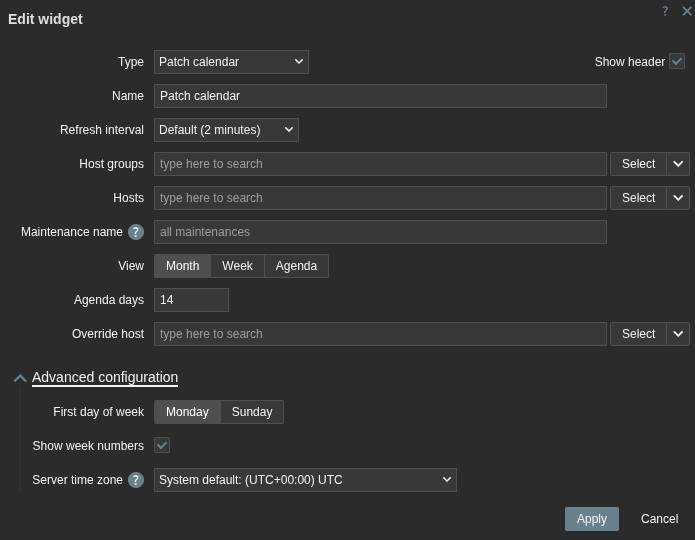
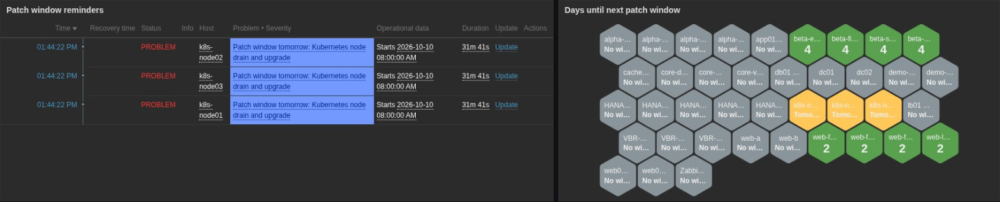

# Patch Calendar

A Zabbix 7.0 dashboard widget that shows maintenance windows (patch windows) as a calendar, and a
template that raises a reminder **the day before** and **on the day** of a host's patch window.

The widget lives in the normal Zabbix dashboard: **Dashboards → Edit dashboard → Add widget →
Patch calendar**. Zabbix has no built-in calendar widget, so this is a widget module rather than a
separate page.



## What it shows

- **Month**: weeks with ISO week numbers, each window as a chip with its start time. Windows that
  continue past midnight appear on every day they cover (`→ 01:00`). When a day is full the
  overflow becomes **+N more**, which lists all windows of that day.
- **Week**: the full time range, maintenance name and scope (host groups and hosts) for each window.
- **Agenda**: upcoming windows grouped by day ("Today", "Tomorrow", …) with a countdown
  (`in 1d 11h 59m`, `ends in 42m`).



Click any window for its details: time, type, schedule, host groups, hosts, active period and
description. Users with access to *Data collection → Maintenance* also get an **Edit maintenance**
button that opens the standard maintenance form on top of the dashboard. Saving it refreshes the
calendar.



Markers:

| Marker | Meaning |
|---|---|
| Color | One stable color per maintenance |
| Hatched | Maintenance *without data collection* |
| Outlined, bold time | Window in progress |
| Dimmed | Window completed |
| Blue dot | Starts tomorrow (same rule as the *Patch window starts tomorrow* trigger) |
| Orange dot | Starts later today (same rule as the *Patch window starts today* trigger) |

## How windows are calculated

Windows are expanded exactly like Zabbix server 7.0 decides that a maintenance is running
(`dc_calculate_maintenance_period()` in `src/libs/zbxcacheconfig/dbconfig_maintenance.c`):

- recurring periods are evaluated in the **server's time zone**;
- a start time that does not exist because of a DST jump is skipped, and a time that occurs twice
  uses the first occurrence;
- "every N days/weeks" is counted from the day/week of *Active since*;
- a window never starts before *Active since* and is cut at *Active till*;
- monthly "day 31" only matches months that have a 31st (no clamping), and "last weekday" is the
  last one of the month.

`tests/MaintenanceScheduleTest.php` compares the expansion with a line-by-line port of the server
code in five time zones around DST changes and month/year ends (~170,000 checks). The template's
JavaScript is checked against the PHP version by `tests/PatchWindowScriptTest.cjs`.

## Widget configuration



| Field | Description |
|---|---|
| Host groups | Maintenances of these groups, or of hosts in them (subgroups included). |
| Hosts | Maintenances that put these hosts into maintenance, directly or through one of their groups. |
| Maintenance name | Only maintenances whose name contains this text, e.g. `patch`. Empty = all. |
| View | Month, Week or Agenda. Users can switch view and page in the widget; this is where it starts. |
| Agenda days | How many days the agenda shows (1–366). |
| Override host | Show the windows of the host selected in another widget or the dashboard. |
| First day of week | Monday or Sunday. |
| Show week numbers | ISO week numbers in the month view. |
| Server time zone | Time zone of Zabbix server. Defaults to the frontend's system time zone; change it only if they differ. |

Host groups and Hosts can also be set to follow another widget, e.g. *Host navigator*.

Times are shown in the user's time zone, like everywhere else in Zabbix. A user only sees
maintenances where they have read permission to all of the maintenance's hosts and groups (Zabbix
API rule for `maintenance.get`).

## Reminders: Patch window by Zabbix API template

`template/Patch window by Zabbix API.yaml` adds one Script item and two triggers to every host it
is linked to. Link it to the standard OS templates, so every Linux and Windows host gets the
reminders without touching the hosts:

- Linux by Zabbix agent, Linux by Zabbix agent active
- Windows by Zabbix agent, Windows by Zabbix agent active

| Trigger | Severity | Fires | Resolves |
|---|---|---|---|
| Patch window starts tomorrow | Information | The calendar day before a window | After midnight, when "today" takes over |
| Patch window starts today | Warning | The day of a window, until it starts | When the window starts (the host then enters maintenance) |

Both change state with the first item check after midnight, i.e. within `{$PATCH.WINDOW.INTERVAL}`.

The problem name includes the maintenance name, e.g. *Patch window tomorrow: Weekly patch window -
Web Farm*. The operational data shows the start time. Problems inherit the item tag
`component: patching` and have `scope: notice`, so a Problems widget or an action can filter on
them. Both triggers allow manual close.

Items:

| Item | Key | Description |
|---|---|---|
| Patch window: Get schedule | `patch.window.get` | Script item, reads the host's maintenances from the API every `{$PATCH.WINDOW.INTERVAL}`. |
| Patch window: Days until next window | `patch.window.next.days` | 0 = today, 1 = tomorrow, -1 = none within `{$PATCH.WINDOW.LOOKAHEAD}` days. |
| Patch window: Next window start / end | `patch.window.next.start` / `.end` | Unix time. |
| Patch window: Next window name | `patch.window.next.name` | Maintenance name. |
| Patch window: In patch window | `patch.window.active` | 1 while a patch window of the host is running. |

"Next window" is the first one that starts after the host leaves its current maintenance, so
back-to-back windows don't raise a reminder while the host is already in maintenance. "Today" and
"tomorrow" use the calendar of the Zabbix server (or proxy) that runs the item, which is also the
time zone the server evaluates maintenance periods in.

Macros:

| Macro | Default | Where | Description |
|---|---|---|---|
| `{$PATCH.WINDOW.API.URL}` | – | Global | URL of `api_jsonrpc.php` as reached **from Zabbix server/proxy**, e.g. `http://zabbix-web:8080/api_jsonrpc.php` in Docker. |
| `{$PATCH.WINDOW.API.TOKEN}` | – | Global, Secret text | API token, see below. |
| `{$PATCH.WINDOW.INTERVAL}` | `15m` | Template | How often the schedule is read. |
| `{$PATCH.WINDOW.LOOKAHEAD}` | `60` | Template | Days to look ahead for the next window. |
| `{$PATCH.WINDOW.NAME.MATCHES}` | `.*` | Template | Regex (case-insensitive). Only matching maintenance names are patch windows. |
| `{$PATCH.WINDOW.NAME.NOT_MATCHES}` | `CHANGE_IF_NEEDED` | Template | Regex (case-insensitive). Matching maintenance names are ignored. |

The URL and token are global macros on purpose: template macros take precedence over global ones,
and re-importing the template would overwrite them.

### API user

Create a dedicated read-only user for the token:

1. **Users → User groups → Create**: e.g. *Patch window API (read-only)*, Frontend access
   *Disabled*, **Read** permission to all host groups that are used in maintenances. A maintenance
   is only visible to the API if the user can read every host and group in it.
2. **Users → Users → Create**: e.g. `svc-patch-window`, role **User role**, the group above.
3. **Users → API tokens → Create API token** for that user, and put it into
   `{$PATCH.WINDOW.API.TOKEN}` as *Secret text*.

### Load

Each host makes two API calls (`host.get` and `maintenance.get`) per interval. With the default
15 minutes, 1,000 hosts make about 2 requests per second. Raise `{$PATCH.WINDOW.INTERVAL}` on very
large installations. Reminders change at most once a day, apart from "today" resolving, which uses
`now()` and doesn't wait for the item.

## Dashboard example



Built-in widgets work well next to the calendar:

- **Problems** with tag filter `component` *Equals* `patching` and *Show operational data:
  Separately*: the active reminders with their start times.
- **Honeycomb** with item pattern `Patch window: Days until next window`, *Show data in
  maintenance*, secondary label `{ITEM.LASTVALUE}` with 0 decimals, and thresholds 0 (orange),
  1 (yellow), 2 (green): every host colored by how soon it is patched.

## Deployment

1. Copy the `Patch_Calendar` directory to `/usr/share/zabbix/modules/`.
2. **Administration → General → Modules → Scan directory**, enable **Patch calendar**.
3. Add the widget to a dashboard.

For the reminders:

4. **Data collection → Templates → Import** `template/Patch window by Zabbix API.yaml`.
5. Create the API user and token, and add the two global macros (**Administration → Macros**).
6. Link *Patch window by Zabbix API* to the OS templates above (template → *Templates* tab).

The Zabbix server or proxy must be able to reach the frontend URL in `{$PATCH.WINDOW.API.URL}`.

## Tests

```
php tests/MaintenanceScheduleTest.php
php tests/export_windows.php > /tmp/windows.json && node tests/PatchWindowScriptTest.cjs /tmp/windows.json
```

The first compares the calendar expansion with the server logic. The second checks that the Script
item's JavaScript expands the same windows, runs the whole script against a stubbed API
(today/tomorrow, filters, back-to-back windows, errors), and checks that the template YAML embeds
`template/patch_window.js` unchanged. If you change the script, update the `params` block in the
YAML too.

## Files

| Path | Purpose |
|---|---|
| `manifest.json`, `Widget.php` | Widget module definition. |
| `includes/WidgetForm.php`, `views/widget.edit.php` | Widget configuration. |
| `actions/WidgetView.php`, `views/widget.view.php` | Data and rendering for the three views. |
| `includes/MaintenanceSchedule.php` | Maintenance window expansion (server algorithm). |
| `assets/js/class.widget.js`, `assets/css/widget.css` | Paging, view switching, "+N more", edit button, light and dark theme styles. |
| `template/` | Template YAML and the readable source of its Script item. |
| `tests/` | Standalone tests (no Zabbix needed). |
