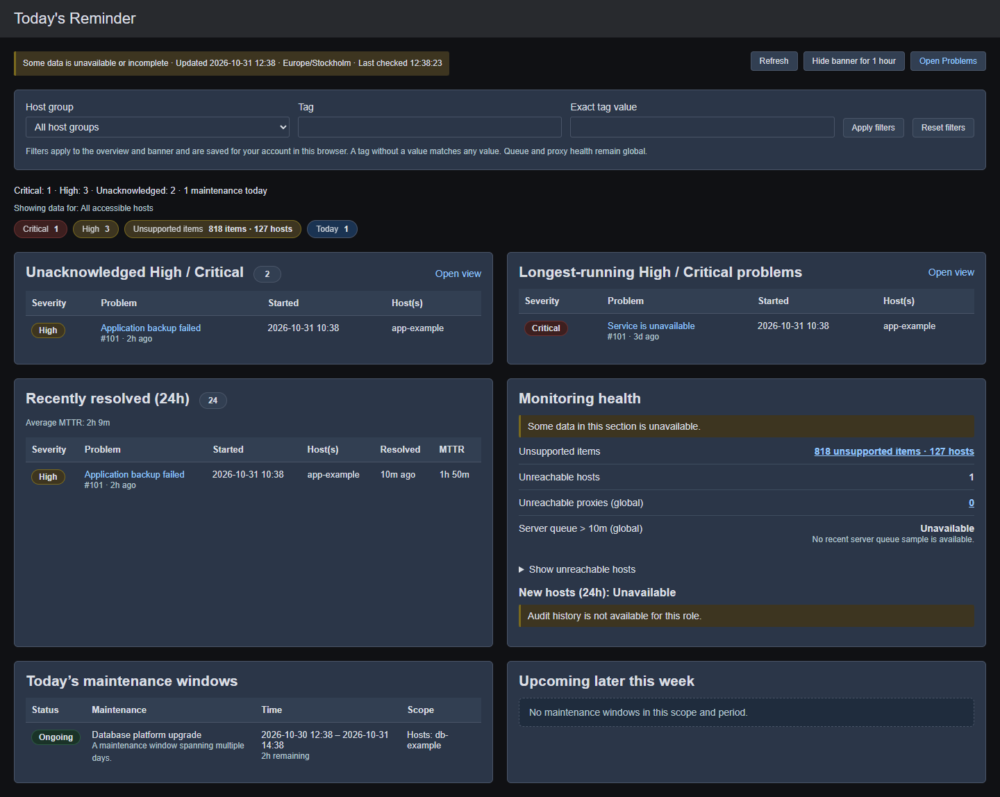

# Today's Reminder

A read-only Zabbix 7.0 frontend module with an operational banner and a detailed overview under **Monitoring → Today's Reminder → Overview**.

Version **1.1.2**. The module ID `Message_of_the_Day` and namespace `MessageOfTheDay` remain stable for upgrades.

## What it shows

- High/Critical and suppressed problem counts, unacknowledged incidents, and the oldest open incidents.
- Problems recovered within the last 24 hours, individual resolution durations, and average MTTR.
- Unsupported items, affected hosts, unreachable monitored hosts (including active-agent availability), proxy health, server queue backlog, and recorded host additions.
- Today's maintenance and upcoming windows later this week, including recurring schedules, complete start/end dates, and remaining time for ongoing windows.
- Host-group and host-tag filters shared with the banner. Tag values match exactly; leaving the value empty matches any value of that tag. Inherited host tags are included.

The overview shows one summary and does not repeat the global banner above itself. Tables scroll within their cards on narrow screens. Unreachable hosts can be expanded inline.

The banner appears at the top of the page content on every frontend page, including module pages that print their own HTML instead of using Zabbix's standard page layout (for example HANA Dashboard and NetBox Sync).



[Mobile layout using synthetic data](docs/images/overview-mobile-1.1.0.png)

## Refresh and preferences

The banner and complete overview refresh every 60 seconds while visible. **Refresh** checks immediately using the same short server cache. Concurrent requests are prevented. The browser waits up to 60 seconds for an answer. A failed refresh retains the last available result with an explicit stale-data message. The generated time describes the cached data; last checked describes the most recent successful request.

For accounts with automatic logout enabled, automatic polling requires new keyboard, pointer, or click activity since the previous request. It pauses while inactive so an abandoned tab cannot keep a session alive indefinitely. Manual refresh requests another check. Accounts with automatic logout disabled (for example, dedicated kiosk accounts) continue polling while visible.

The banner always starts collapsed. **Expand** shows the details on the current page; they stay open while that page refreshes. The next page load, or the banner's return after a snooze, starts collapsed again. **Snooze for 1 hour** on the banner, or **Hide banner for 1 hour** on the overview, hides it; **Show banner again** on the overview brings it back early.

Filters and snooze are saved per account and installation in this browser, not across devices. Browsers that block storage use an in-memory fallback for the current page.

## Coverage and permissions

Unknown is not zero. Failed queries, restricted access, stale queue samples, and incomplete scans are labeled unavailable or partial. A failed section never displays an all-clear conclusion. The displayed filter scope remains visible when a subsequent refresh fails.

Both routes require at least `USER_TYPE_ZABBIX_USER`. Zabbix module-role restrictions and the logged-in user's API permissions remain in effect. No credentials or elevated service account are required.

Host filters apply to problems/events, unsupported items, host availability, relevant maintenance, and host additions. An empty match stays empty; it never falls back to all hosts. Server queue and proxy health remain installation-wide metrics subject to API permissions and are labeled **global**.

New hosts counts recorded host-addition audit entries. Audit access requires a Super Admin, and discovery coverage depends on audit settings. Missing audit access or disabled audit logging is shown as unavailable. Disabled system-action logging makes the count a lower bound. Five recent additions are listed; the total uses a separate count query and is not capped at 20.

Server queue data comes from a monitored, server-monitored `zabbix[queue,10m]` item and requires a sample from the last 15 minutes. Proxy queue data is not substituted for a missing server sample.

## Maintenance timezone

Recurring maintenance is calculated in the **Zabbix server's timezone**; timestamps are displayed in the frontend user's timezone. The module uses the frontend's configured default timezone, falling back to PHP's configured `date.timezone` (UTC if absent). Ensure this matches the server. If they differ, set the PHP/web-container environment variable:

```text
MOTD_MAINTENANCE_TIMEZONE=Europe/Stockholm
```

Use the actual timezone of your Zabbix server. An invalid override makes maintenance unavailable instead of silently moving windows. Durations use elapsed seconds across DST; skipped spring clock times do not create occurrences, and monthly day 31 does not move to shorter months. Daily/weekly interval phase follows the Zabbix 7.0 scheduler's calculation.

## Performance and limits

- A private file cache in the system temporary directory lives for 45 seconds. Keys include installation, user, role/group-set identity, filters, language, display/scheduling timezones, and cache version. Unix cache directories use mode 0700 and files 0600. The module works without a writable cache. Permission changes can take up to the cache lifetime to appear.
- Recovery reporting pages through events overlapping the last 24 hours, including older starts that recovered during the period. It examines up to 20,000 candidates. If incomplete, the count is a lower bound and average MTTR is unavailable.
- Zabbix evaluates the recovery report's filter across the whole event history, so it is the most expensive part of the collection. Only the overview builds it; banner refreshes skip it. It runs after every other section, and the overview reuses a successful report for five minutes. A failed or cut-short report is retried on the next refresh.
- Filter resolution permits up to 20,000 matching hosts; larger scopes require a narrower filter.
- Host availability examines up to 5,000 monitored hosts. The inline list shows up to 50 unreachable hosts. Truncation is disclosed.
- Unsupported-item totals use a count query. The affected-host minimum is calculated from at most 2,000 item rows, with a visible qualifier if truncated.
- Collection checks a 20-second work budget between API calls. A slow individual call can still run longer. The browser waits up to 60 seconds, the controllers' PHP time limit, before it marks the previous result stale.
- Native drill-downs carry supported filters. Large selected scopes that would produce oversized URLs stay in the overview. Incident links open the specific event.

## Installation / upgrade

1. Copy this entire directory into `ui/modules/Todays_Reminder/`, replacing previous files.
2. In **Administration → General → Modules**, scan if necessary and enable Today's Reminder.
3. Reload the frontend. Versioned filenames load the updated JavaScript and CSS.
4. Check the overview with a Super Admin and a restricted account. Verify group/tag filters, an incident link, snooze/resume, and maintenance against native Zabbix views.

No database migration is required. Upgrading from 1.1.0 or 1.1.1 keeps saved filters and any active snooze; end a snooze early with **Show banner again** on the overview. Expand/collapse choices saved by 1.1.0, and banner storage from versions before 1.1.0, are ignored. This repository update does not deploy files to a running frontend.

## Local validation

Regression fixtures contain synthetic data and do not connect to Zabbix:

```text
php tests/MaintenanceScheduleTest.php
php tests/MotdDataProviderTest.php
php tests/RequestContextTest.php
php tests/ControllerTest.php
node tests/MotdUiTest.cjs
```

Browser checks use Playwright with headless Microsoft Edge on Windows; the runner supports `MOTD_BROWSER_CHANNEL`. PHP checks can run in disposable `php:8.4-cli` containers with networking disabled, a read-only module mount, and a writable temporary filesystem for cache fixtures.

For a synthetic visual preview, run `php -S 127.0.0.1:18931 tests/Preview.php` from this directory and open `/zabbix.php?action=motd.view`. The preview refuses to run under PHP-FPM/Apache. Local fixtures validate module logic and presentation; API/role/schedule behavior still needs verification on the target deployment.

## 1.1.2 changes

- Fixed frequent "Refresh failed" messages. The browser gave up after 20 seconds, the same length as the server's collection budget, so any slow collection failed. It now waits up to 60 seconds.
- Banner refreshes no longer build the 24-hour recovery report. It scans the whole event history, and the banner never shows it. The overview builds it last, without a separate count query, and reuses it for five minutes.
- When the time budget runs out, only the recovery report is affected. Before, maintenance was collected last and the banner showed "Maintenance today: unavailable".

## 1.1.1 changes

- Fixed the banner breaking the layout on module pages without a `<main>` element, such as HANA Dashboard and NetBox Sync. In Zabbix 7.0 it was added as an extra column beside the sidebar, which squeezed the page. This happened every time the banner was shown on such a page, including when it returned after a snooze. Version 1.0.0 handled these pages; the 1.1.0 rewrite lost that. The banner now sits at the top of the page content.
- The banner now always starts collapsed. Expanding applies to the current page only, and expand/collapse choices saved by 1.1.0 are ignored.

## 1.1.0 changes

Corrected failure reporting, banner fingerprints, recovery-window coverage, host-addition totals, maintenance DST/month-end handling, and health drill-downs. Added whole-overview refresh, host-group/tag filtering, visible freshness and coverage, user-specific snooze/preferences, accessible controls, idle-session-aware polling, private cache files, and regression tests.
