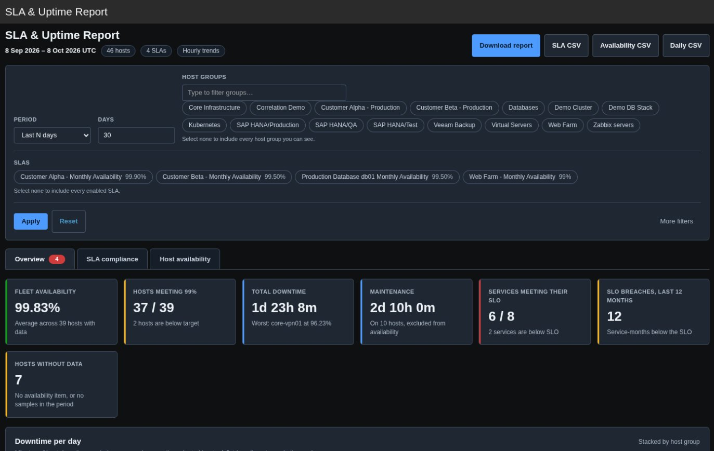
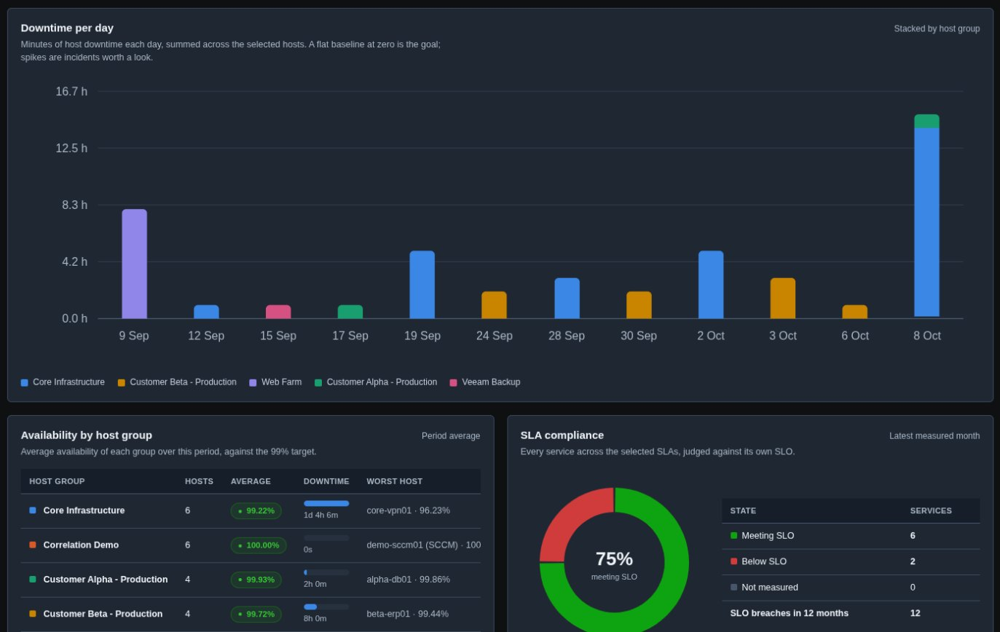
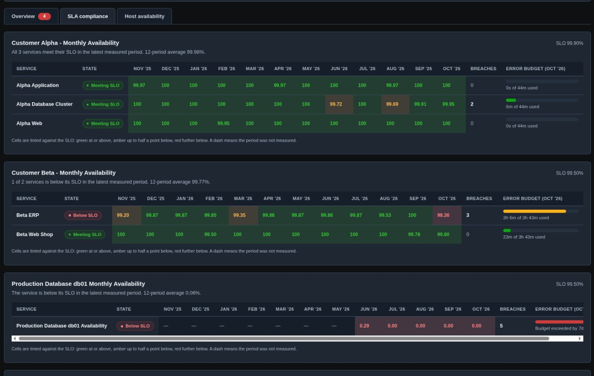
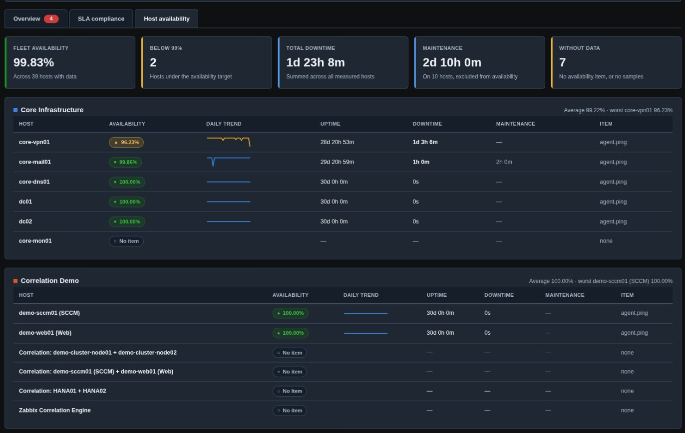
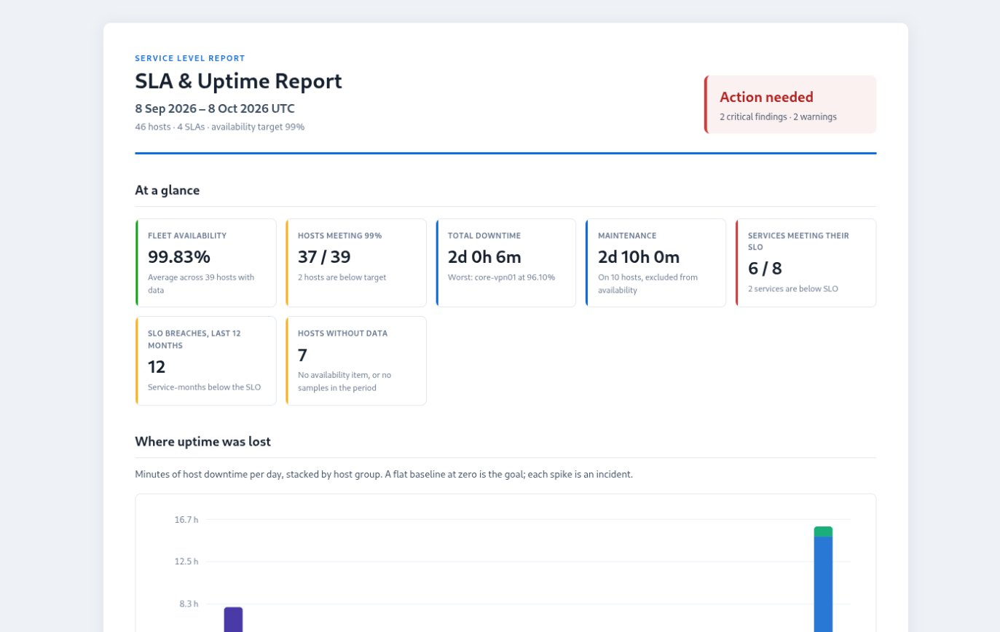
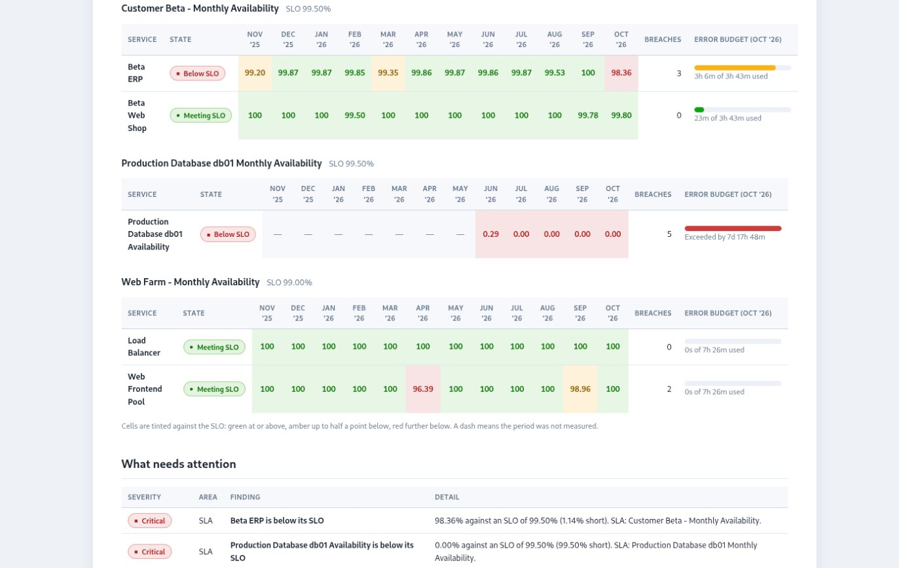

# SLA & Uptime Report

A Zabbix 7.0 frontend module that turns Zabbix's SLA engine and host availability items into a
report you can put in front of both an operations team and a customer.

It answers three questions on one page:

1. **Are we meeting our commitments?** — every service across every SLA, judged against its own
   SLO, with a rolling 12-month heatmap and this period's error budget.
2. **How available were the hosts?** — per-group uptime with daily trend sparklines, measured
   from each host's availability item.
3. **Where was uptime lost?** — downtime minutes per day, stacked by host group, so each
   incident is visible as a spike.

Menu location: **Reports → SLA & Uptime Report**.



---

## The three tabs

All three are rendered from a single data build, so no tab can show a different version of the
truth.

### Overview

Headline figures, the daily downtime chart, availability by host group, SLA compliance at a
glance, and a prioritised "needs attention" list — services below SLO first, then hosts below
the availability target, worst first.



### SLA compliance

One card per SLA. Each service gets a 12-month SLI heatmap tinted against the SLO — green at
or above, amber up to half a point below, red further below — with the value printed in every
cell, a breach count, and an **error budget** for the current period: how much of the allowed
downtime has been consumed, and by how much it was exceeded when it was.



### Host availability

Every availability check, grouped by host group and sorted **worst first**, with availability, data coverage,
a daily-trend sparkline, uptime, downtime, total maintenance time, and the measurement item/source.
The maintenance column is always visible, including zero values and hosts without an item.
Overlapping windows count once and only the part inside the report period is included.

Click a **host or measurement name** for its measurement rule, named maintenance windows, and separate lists
of missing readings and observed failures with UTC start/end times and durations. Evidence
intervals have exclusive end times and are split at midnight UTC. The back link preserves
the original report filters. Hosts with multiple checks have a measurement selector. Click
**Without data** on either tab for every missing check, including rows hidden by the display cap.
The header counts physical hosts and checks separately. Averages and downtime combine checks;
they are not the percentage of time all websites were available together. Headline maintenance
time counts each physical host once, even when the host has several checks.



### Settings

The **Settings** pane is visible only to Administrators and Super administrators. Administrators
can inspect settings for objects they can read. **Only Super administrators can save shared
settings**, following Zabbix's [module.update permissions](https://www.zabbix.com/documentation/7.0/en/manual/api/reference/module/update).
Rules are stored in Zabbix's module configuration, shared across frontend instances, and saved
through the audited module API. No writable module directory or extra database schema is required.

- Set a global item rule, override it for a host group, or override it for an individual host.
  Precedence is **host → group → global**. Among matching group rules, the lowest priority
  number wins; ties use the lowest group ID. Group rules use direct membership.
- Since **2.3.0**, add several explicit host rules with different item keys to measure several
  URLs/scenarios on one host independently. Give each a **Measurement name**. These host rules
  replace the inherited group/global rule; do not mix Automatic and explicit rules on that host.
  The same key cannot be added twice to one host. Existing single-rule settings continue to work.
- Add all host/group rows before clicking **Save shared settings**; one save stores the complete
  form. Since **2.3.1**, rejected saves retain the submitted rows and show a notice beside the
  save controls linking to the error at the top. Correct the invalid row and save again. If settings changed
  in another session, retain your draft separately and reload before applying it to the newer settings.
- Choose automatic ping fallback, numeric value `1`, an exact healthy value, or an inclusive
  healthy range. For example: key `web.test.rspcode[Website,Home]`, **Equals 200** or **Range 200–399**.
  Use the actual item key from your Zabbix installation. Only enabled numeric items are selected;
  an absent explicit key shows **No item**, without silently falling back to ping.
- **Poll seconds** defaults to `0`: use the item's delay or estimate cadence from readings.
  For web scenario or dependent items whose delay is `0`, enter the actual collection interval
  in seconds when known. This also enables eligible gaps to offer maintenance creation.
- Exclude hosts or groups from host availability, counts, charts and exports. Excluding a
  group excludes its directly assigned hosts even if they also belong to another selected group.
  Zabbix service SLAs are calculated separately and are not changed by host exclusions.
- A stale settings form cannot silently overwrite a newer saved version. Invalid stored
  configuration stops report generation instead of silently using different rules.
- **Report cache** controls reuse of numeric history and trend readings. It is enabled by default;
  only a Super administrator can change this shared setting. See the cache details below.

### Measure uptime from a web scenario

Web scenarios create real numeric measurement items automatically. You do not need to create
a separate ordinary item. The response-code key format is:

```text
web.test.rspcode[Scenario name,Step name]
```

Both parameters are the **names configured in Zabbix**, which may be URLs or friendly text.
They are case-sensitive: preserve path capitalization, query strings, trailing slashes and
step-name prefixes. The full display text `Response code for step ...` is not the item key.
See [Zabbix web monitoring items](https://www.zabbix.com/documentation/7.0/en/manual/web_monitoring/items).

The following key was confirmed working for the supplied Secure homepage check:

```text
web.test.rspcode[https://secure.landshypotek.se/,https://secure.landshypotek.se]
```

To configure it:

1. Sign in as a Super administrator and open **Reports → SLA & Uptime Report → Settings**.
2. Under **Host and website measurements**, select `secure.landshypotek.se` (host `10914` in the supplied example).
3. Enter these values and select **Save shared settings**:

| Field | Value |
|---|---|
| Measurement name | Secure homepage |
| Exact item key | The confirmed `web.test.rspcode[...]` key above |
| Healthy-value rule | Equals healthy value |
| Equals | `200` |
| Minimum / Maximum | Not used by Equals; leave defaults |
| Poll seconds | Actual scenario update interval in seconds, e.g. `60` for `1m` |

4. Reopen the report and check that the measurement row displays the chosen item and usable coverage.
   Open the row to inspect the healthy-value rule, missing readings and failed-reading spans.

**Use the expected value for each check.** A page that must return `200` should use Equals `200`.
An endpoint whose healthy behaviour is a `302` redirect should use Equals `302`. Do not set every
check to `302`, or widen every rule to `200–399`, just because two endpoints intentionally redirect.
The value is the response code collected by the scenario step; redirect-following configuration
can make another step collect the final destination's `200` instead. The step name alone does not
establish its expected response. [Zabbix step configuration](https://www.zabbix.com/documentation/7.0/en/manual/web_monitoring)

**Poll seconds is not Last check.** Values such as `28s` or `1m` in Latest data show the sample's
age. Read the scenario's configured update interval for its polling cadence. Leaving Poll seconds
at `0` uses the item delay or an estimate from history; web/dependent items often require an explicit
interval for reliable gap inference and eligible per-gap maintenance creation.

For full scenario success, an alternative is `web.test.fail[Scenario name]` with **Equals `0`**.
Zero means every scenario step passed. Configure required status codes and any content checks in
the scenario; an empty Required status codes field performs no status-code validation. This is a
different measurement from checking only a response code.

Custom Equals/Range rules use **raw history even for long reports**. Keep sufficient history for
the reporting period and inspect coverage. These rules affect the module's Host availability;
native SLA compliance still comes from Zabbix Services/SLA configuration.

#### Import the ten supplied Landshypotek checks

The ready-to-paste [Landshypotek check list](examples/landshypotek-web-checks.tsv) contains all ten
host/item pairs supplied, preserving the separate central-monitor and individual-host results:

| Host | Independent checks | Healthy values |
|---|---|---|
| Landshypotek Website URL Monitor | Kundkannedom; SME login; redirected Secure overview destination | `200`, `200`, `200` |
| kundkannedom.landshypotek.se | Kundkannedom | `200` |
| secure.landshypotek.se | Homepage; loan login; overview | `200`, `302`, `302` |
| sme.landshypotek.se | SME login | `200` |
| loggain.landshypotek.se | Loggain | `200` |
| www.landshypotek.se | WWW | `200` |

1. Copy the entire TSV file as text, including its optional header.
2. Expand **Settings → Host and website measurements → Add website measurements from a table**,
   paste the text, and select **Import measurements**.
3. Review all ten host rules and set their actual Poll seconds. The prepared file uses `0`
   because polling intervals were not supplied.
4. Select **Save shared settings**. Importing into the form alone does not save configuration.

The browser matches host names exactly to the accessible host suggestions. A missing or ambiguous
name rejects the entire import; use a listed host ID in the TSV if necessary. For a host beyond
the suggestion limit, add its measurement manually using its host ID, save, and reopen settings
so the configured host appears in the accessible suggestions before importing more checks.
Reimporting updates matching host/key rules without creating duplicates. Other explicit rules are
preserved; an Automatic host override is replaced for hosts included in the import. The prepared
keys follow the supplied scenario/step names; only the Secure homepage key was confirmed on the
live installation. A renamed or differently configured scenario must use its actual current key.

### Create maintenance for an individual gap

An administrator with Zabbix maintenance permission and write access to the host can expand
**Create maintenance** on each eligible missing-data interval, enter a reason/change reference,
confirm that the gap was planned maintenance, and submit that one window. Different gaps and
days have separate actions. The server checks permissions and re-reads the evidence before saving.

Creation requires a complete raw-history scan, a known polling interval, and readings bounding
the gap. Retention boundaries, no-sample periods, flexible/estimated schedules, observed failed
readings and hourly trend gaps remain inspectable but do not offer automatic creation.
Zabbix requires at least **five whole minutes** and rounds maintenance periods to minutes;
the proposed window is rounded **inside** the gap, never extended over healthy readings.
See the [maintenance period API](https://www.zabbix.com/documentation/7.0/en/manual/api/reference/maintenance/object).

This creates a real, host-only, retrospective Zabbix maintenance with data collection enabled.
On a host with several websites, it excludes that time from **every check on that host**;
it is not a website-only exclusion. The confirmation states this host-wide effect.
It changes subsequent host reports and records the reason in the maintenance description.
It does not recreate past problem suppression or rewrite historical SLA calculations.
Repeated submissions use the same maintenance name to avoid creating the same window again.

---

## Error budgets

An SLO is easier to manage as a budget than as a percentage. For each service the module
converts the SLO into allowed downtime for the current period and shows how much is spent:

- **SLO 99.9% on a 31-day month** → 44 minutes of allowed downtime.
- A service at 99.08% mid-month shows *"Budget exceeded by 1h 35m"* in red.
- A healthy service shows *"0s of 44m used"*.

The bar turns amber at 80% consumed and red at 100%, and a service that is still meeting its
SLO but has eaten most of its budget appears in the attention list before it breaches.

---

## How availability is measured

By default each host is measured from the first enabled numeric item among these keys:
`agent.ping` → `icmpping` → `zabbix[host,agent,available]`.

The calculation source follows the window length:

- **≤ 7 days → raw history.** Availability = OK samples / expected samples, where the expected
  count includes inferred missing samples — a polling gap counts as downtime rather than
  hiding. The polling interval comes from the item's delay, falling back to the median
  observed interval.
- **> 7 days → hourly trends for unsigned binary items.** An hour is up only when its minimum
  and maximum are both `1`; mixed or failed hours count as down conservatively. Covered hours
  are clipped to the selected period. Hours with no data are excluded from availability,
  uptime and downtime; the totals are never stretched over the uncovered time. A host with
  no coverage reports *No data*.
- **Custom comparisons or floating-point items → raw history for every period length.**
  An hourly average cannot reconstruct an HTTP response-code or threshold success rate.
  Keep sufficient raw history for these reports and check coverage: deleted history and an
  actual polling outage cannot be distinguished automatically.

**Coverage** is observed samples / expected samples for raw history, or covered eligible
seconds / eligible seconds for trends. Maintenance is removed first (whole touched hours on
the trend path). A warning identifies measured hosts with incomplete coverage. Raw percentages
use sample counts; drilldown spans infer duration from polling cadence, so their duration totals
can differ. These boundaries are evidence to investigate, not proof of an exact outage time.

The page always says which source it used, and what that means for precision.

### Maintenance windows

Downtime inside a maintenance window (*Data collection → Maintenance*) is **accepted downtime**:
that time is left out of the host's measured time, so it counts as neither uptime nor downtime.
The host table, the KPI cards, the export and the availability CSV show the maintenance time
separately.

The module applies maintenance the way the Zabbix server does:

- A maintenance covers the hosts it lists **and every host in its host groups**, including
  nested groups — a maintenance on `Linux` also covers hosts in `Linux/DB`.
- Both maintenance types count: with and without data collection. On the history path a
  polling gap during a no-data maintenance therefore costs nothing.
- One-time periods are clipped to the maintenance's *Active since/till*. Daily, weekly and
  monthly periods (including "every N days/weeks" and "first … last weekday of the month")
  are expanded exactly as the server runs them, including skipping a start time that a DST
  change makes not exist.
- A maintenance **limited to problem tags does not count**. It only suppresses the matching
  problems, so a host outage was never part of what it accepted. The report lists any such
  maintenance that would otherwise have applied.

Points to be aware of:

- **Time zone.** The server runs recurring periods in its own local time zone, which the
  frontend cannot see. The module uses the frontend's default time zone (*Administration →
  General → GUI → Default time zone*, where *System* means PHP's configured zone) and names it
  on the page. **Set it to the Zabbix server's time zone**, or recurring windows will be
  shifted by the difference.
- **Hourly trends (> 7 days).** An hour that touches a maintenance window is excluded whole.
  The server floors integer trend averages, so a single down sample inside the window marks
  the whole hour as down. Keeping the hour would charge accepted downtime to the minutes
  around it. Raw history (≤ 7 days) is cut at the exact second.
- **Configuration as it is now.** Zabbix keeps no history of maintenance windows, so they are
  rebuilt from the current configuration. Expired maintenances keep working for past reports
  until someone deletes them. A deleted maintenance no longer applies, and an edited one
  applies as edited.
- **Permissions.** Maintenances are read with the viewer's permissions. Zabbix only returns a
  maintenance to a non-super-admin who can read *all* of its hosts and host groups, so a
  maintenance that also covers other customers' groups is invisible to a customer-scoped user
  and is not applied to their report. The page says so for such users. Generate customer
  reports as a super admin, or scope maintenances per customer.
- A host that spent the whole period in maintenance shows **In maintenance** instead of a
  percentage. It counts neither as measured nor as "without data".

### SLI numbers

SLI values come from the Zabbix SLA engine (`sla.getSli`) — the same numbers the native SLA
report shows — so this module never disagrees with Zabbix about compliance. Maintenance needs
no handling here: the SLA engine already ignores problems suppressed by a maintenance. Use the
SLA's *Excluded downtimes* for planned work that is not set up as a maintenance. One subtlety the
module handles: the SLI matrix columns follow the API **response's** service order, not the
request's, and mapping them naively attributes one service's SLI to another.

---

## Filters

| Filter | Notes |
|---|---|
| **Period** | Last N days, previous month, a specific month, or a custom range. All UTC. |
| **Host groups** | Selectable pills; a search box filters the list when it is long. None = all. |
| **SLAs** | Pills showing each SLA's SLO. None = all enabled SLAs. |
| **Availability target** | Default 99.0%. Hosts below it are flagged; below 90% is critical. |
| **Rows per group** | Table cap per host group. Health counts are never truncated. |
| **Exclude disabled hosts** | On by default. |

**Reset** returns everything to defaults. Tabs, filter and downloads all carry the full filter
state. Since **2.4.0**, the filters appear before the expensive measurements are loaded. Applying
a filter updates the report in the background, with a moving progress bar and elapsed time.
Older results are marked stale and their downloads are disabled until the new selection finishes.
Late responses cannot overwrite a newer selection. Errors offer a retry.

**Refresh data** re-reads the selected measurement period and updates its cache. The status shows
how many readings were reused or loaded. The progress bar is indeterminate: it indicates work in
progress, not an invented completion percentage. Without JavaScript, use **Load report without
JavaScript** to generate the complete page synchronously; filters and downloads remain available.

---

## Exports

**Download report** produces a single self-contained HTML file — inline CSS, inline SVG, no
external requests — with a cover verdict, the headline figures, the downtime chart, every SLA
heatmap with error budgets, the attention list and the full host tables. It prints to A4
landscape (use the browser's *Print → Save as PDF* for a PDF).





CSV exports: the SLA heatmap (one row per service-month), host availability (with uptime,
downtime and maintenance seconds, data coverage, measurement label/ID and source per check), and daily downtime per group. All CSV cells are
neutralised against spreadsheet formula injection.

HTML and CSV generation show a moving progress bar and elapsed time while the server prepares
the file. Duplicate download clicks are disabled until it finishes. Exports use the same numeric
cache and recompute their results with current rules and permissions. The HTML footer identifies
cache reuse and the report generation time. Export remains HTML/CSV; no server PDF library is required.

---

## Requirements

- Zabbix **7.0** frontend (single-server, multi-server/HA or Docker).
- Any user with at least the *Zabbix user* role can open the report; data is scoped by the
  user's host group and service permissions.
- **For the SLA side:** enabled SLAs under *Services → SLA* with services linked by service
  tags.
- **For the availability side:** an `agent.ping`, `icmpping` or `zabbix[host,agent,available]`
  item on each host you want measured, or an enabled numeric item configured in Settings.

---

## Install / enable

1. Copy this directory to `ui/modules/sla_uptime_report` in the Zabbix frontend (for Docker,
   mount it into the web container at the same path).
2. **Administration → General → Modules → Scan directory**.
3. Enable **SLA & Uptime Report**.
4. Open **Reports → SLA & Uptime Report**.

For an upgrade, replace the module files, scan the directory again to refresh the module version
and new actions, and reload the frontend assets. Version **2.4.0** adds the background report-data
action, incremental measurement caching, and loading/export progress. Scan the directory after
copying **all** files so that `slareport.report.data` is registered, then hard-refresh the browser.
Version **2.3.1** retains entered rows when a save
is rejected. Version **2.3.0** added multiple website checks per host and form import; 2.2.0 introduced
host detail, maintenance creation and settings routes. If the page still says **Host overrides**
and rejects a second scenario for a host, replace the entire module directory with this version
and reopen settings; the updated section is called **Host and website measurements**.
Existing measurement rules and exclusions retain their behaviour. The new cache setting defaults
to enabled; existing configuration is not otherwise replaced.

---

## Accuracy notes

Places where the obvious implementation would have been wrong, and what the module does
instead:

- **`sla.getSli` reorders services** in its response; the module maps SLI columns by the
  response's service ids, not the request order.
- **A missed poll is downtime**, not missing data, on the history path — and the reverse on
  the trends path, where an uncovered hour is excluded from the denominator instead of being
  counted as downtime, because trend gaps usually mean retention, not outage.
- **"No item" and "no data" are answers**, shown as such — never silently dropped, and never
  averaged into the fleet number.
- **Health counts, the attention list and the export cover every matching host**; the
  per-group row limit truncates tables only.
- **Chart colours follow the host group**, with collisions among the groups on screen resolved
  to free slots so two adjacent series never share a colour.
- **One unit per axis** — the downtime axis picks minutes, hours or days from its maximum and
  every tick and tooltip uses it.
- **`zabbix[host,agent,available]` reports 2 for "unavailable"** — each sample is decoded by
  band, so an agent that is down counts as down instead of being clamped into uptime.
- **A filter that stops resolving narrows to nothing and says so.** A selected group that lost
  its hosts, or an SLA that was disabled, must never silently widen a customer export to
  every host and SLA the account can read.
- **Zero samples is "no data", never "0% available"** — a dead item, a scan cap and a
  decommissioned host all look the same, and inventing a hard-down verdict would page someone
  about a host that may be fine.
- **Maintenance is cut out, not converted into uptime.** Time inside a maintenance window
  leaves the denominator, the same way Zabbix's SLA engine treats excluded downtime, so a
  host that was fine outside its patch window reports 100%. It is not credited with the
  window as if it had been up.
- **Maintenance groups are matched like the server matches them**: nested groups included,
  tag-limited maintenances excluded, and recurring periods expanded with the server's own
  day, week, month and DST rules. These rules were checked against a port of the server's
  period code.

---

## Performance & limits

The first page request loads filter options; the data request calculates the complete report in
the background. Host/item lookup remains batched. Raw history is queried per item in bounded time
slices with 10,000-row pages, avoiding repeated sorting across many items over the entire remaining
period. Cold trend reads are batched across items, with weekly cache coverage tracked per item.
Slices are folded into counters and discarded; the full period's raw readings are never kept together.

### Incremental measurement cache

The cache stores numeric readings and successfully queried intervals, including empty intervals.
Changing the period reuses overlapping data and requests missing intervals. It also refreshes the
last **15 minutes of raw history**, or the last **two hours of hourly trends**, to pick up delayed
readings and changing trend buckets. Older populated intervals expire after **24 hours**; entirely
empty intervals are retried after **60 seconds**. Refresh data forces a new read of the selected range.
This means repeated reports may still make small recent-data requests, even if the period is unchanged.

The cache is independent of the final availability calculation. Every report resolves accessible
hosts/items again and reapplies current healthy-value rules, exclusions and maintenance. Changing
those settings takes effect immediately without clearing numeric history. Native service SLIs
continue to come directly from Zabbix on each report. Host detail and maintenance creation also read
their evidence directly. Cached historical readings may temporarily outlive Zabbix retention changes
or corrections until expiry; use Refresh data when an immediate re-read is needed.

Storage is private to the Linux frontend process, outside the web root. By default it is beneath
`sys_get_temp_dir()/zabbix-sla-history-<uid>`, separated by installation/database identity. Directories
use mode `0700` and files `0600`. Cache payloads contain numeric readings, timestamps and interval
coverage, with hashed series identifiers; no host names, item keys, credentials or rendered reports.
Writes are atomic, compressed and limited to **256 MiB / 4,096 data files** per installation. Weekly
shards have a 30,000-row and 8 MiB decoded JSON limit. Large shards, missing permissions, unavailable
compression or unsafe storage fall back to live data. Partial API scans are never cached as complete.

Optional PHP/frontend environment variables:

| Variable | Purpose |
|---|---|
| `SLA_REPORT_CACHE_DIR` | Private, writable cache root outside the web root, for example `/var/cache/zabbix-sla`. Its ownership must match the frontend process. |
| `SLA_REPORT_CACHE_NAMESPACE` | Explicit namespace in place of automatic database identity; use a distinct value for each independent installation, especially clones. |

No module-directory writes or extra database schema are needed. Frontend replicas can keep separate
local caches; each warms independently. Cache failure affects speed, not authorization or the
availability rules. The status reports whether readings were reused or loaded live.

| Guard | Value |
|---|---|
| Hosts measured | 2 000 |
| SLAs | 200 |
| History samples scanned | 2 000 000; 10 000 rows per API page, at most 30 000 rows per slice |
| Trend rows per API call | ~50 000 (chunk size adapts to the window length) |
| Per-day sparklines | first 400 hosts (totals and charts cover every host) |
| Maintenances read | 5 000, most recently ending first (only those active in the window are expanded) |
| Report window | 768 days |
| Settings overrides | 100 total host/group rules |
| Host evidence / maintenance occurrences listed | 5 000 each per drilldown; truncation is reported |
| Page time limit | 300 s |

When a cap actually truncates something, the page says so rather than quietly showing a
partial answer.

In a synthetic seven-check, 30-day raw-history regression, the first load made 63 history queries,
an unchanged warm load made zero, and extending the period by five minutes made seven queries for
only the extension. This verifies query reuse, not production response times. The first load still
needs the selected data, and native SLI calculation and report rendering are not cached.

## Local validation and live pilot

Focused offline regression files under `tests/` cover settings selection/exclusions, numeric
history types, sparse and partial-hour trends, pagination, gap boundaries, maintenance subtraction,
permissions, tampered submissions and retry handling. Run each PHP test in a separate process:

```powershell
docker run --rm --network none --read-only --tmpfs /tmp:rw,noexec,nosuid,size=192m --cap-drop ALL --security-opt no-new-privileges -v "${PWD}:/work:ro" -w /work php:8.4-cli sh -c 'for test in tests/*Test.php; do php -d memory_limit=128M "$test" || exit 1; done'
```

`tests/UiTest.cjs` and `tests/AsyncUiTest.cjs` render synthetic PHP fixtures and exercise the pages,
filter races, loading states and exports in Playwright. They need
Docker, a locally cached `php:8.4-cli` image and Playwright. Optionally set `SLA_PLAYWRIGHT_PATH`
to an existing Playwright installation and `SLA_BROWSER_CHANNEL=msedge` to use installed Edge.
Screenshots go to the OS temporary directory; no test contacts or changes a Zabbix server.

Before production rollout, use a Zabbix 7.0 test instance to verify:

1. Regular user, scoped Admin and Super Admin navigation, direct-action access, and maintenance permissions.
2. Settings save/reload across frontends and a known web scenario response-code item/poll interval.
3. Excluded hosts/groups absent from cards, tables, charts and both export formats.
4. A known raw-history gap and overlapping maintenance windows against native Zabbix evidence.
5. One deliberate test maintenance creation, its exact host/time/reason, recalculated host availability,
   and a repeated submission; historical SLA results must not be assumed to change.
6. A long trend period with retention gaps, checking covered durations and incomplete-coverage warnings.
7. A cold report, a repeated report and an extended period: compare values, cache status and load times.
8. Rapid filter changes, Back/Forward, Refresh data, and HTML/CSV progress through completion or retry.

Offline tests are not a live Zabbix integration validation.
